In LaTeX, there are certain features which allow producing structures that can grow to any required size. Mathematical typesetting is in dire need of such variability. We will discuss some aspects of it in this article. All commands covered in this section (unless otherwise noted) are provided by standard LaTeX.


## 5.1. Ellipsis...

The `amsmath` package replaces (in almost all cases) all those `\ldots`, `cdots`, etc. from standard LaTeX with the single `\dots` command. Both the vertical position of the ellipsis and the space around it are automatically selected depending on the type of the symbol following `\dots`. If the next symbol is, say, a plus sign, the dots will come out centered; if it is a comma, they will fall on the baseline. It's always three dots but the spacing is variable.

```tex
\usepackage{amsmath}
% -------------------------------------------------------------------------------
A series $H_1, H_2, \dots, H_n$, a sum
$H_1 + H_2 + \dots + H_n$, an orthogonal product
$H_1 \times H_2 \times \dots \times H_n$.
```

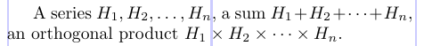

However, when the dots happen to appear at the end of a formula, the next object will be something like `\end` or `\)` or `$`, and it gives LaTeX no clue about the positioning of the dots. In such a case, you must help by using `\dotsc` for dots followed by commas, `\dotsb` for dots followed by *Binary operator* or *Relation symbol*, `\dotsm` for dots followed by multiplication dots, `\dotsi` for dots followed by integrals, or `\dotso` in any other case.

```tex
\usepackage{amsmath}
% -------------------------------------------------------------------------------
A series $H_1, H_2, \dotsc\,$, a sum
$H_1 + H_2 + \dotsb\,$, an orthogonal product
$H_1 \times H_2 \times \dotsm\,$, and an infinite
integral: \[ \int_{H_1} \int_{H_2} \dotsi \;
{-\Gamma}\, d\Theta \]
```

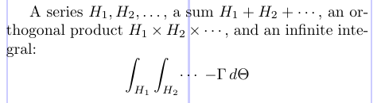

## 5.2. Symbols that are horizontally extensible

Basically, LaTeX allows setting up any math accent command to produce the appropriate glyph from a range of widths whenever these are provided by the available fonts. However, in standard LaTeX there are only two such commands: `\widehat` and `\widetilde`.

In the next example, we demonstrate the use of a few commands that produce constructs similar to the aforementioned extensible accents. They all produce compound symbols of math class *Ordinary*.

```tex
\usepackage{amsmath}
% -------------------------------------------------------------------------------
\begin{align*}
\widehat {\psi_\delta(t) E_t h}
&= \widetilde {\psi_\delta(t) E_t h} \\
\overline {\psi_\delta(t) E_t h}
&= \underline {\psi_\delta(t) E_t h} \\
\overbrace {\psi_\delta(t) E_t h}
&= \underbrace {\psi_\delta(t) E_t h}
& & \text{Do not change style} \\
\overrightarrow {\psi_\delta(t) E_t h} 
&= \overleftarrow {\psi_\delta(t) E_t h}
& & \text{Do not change style} \\[-3pt]
& & & \text{without \textsf{amsmath}} \\
\underrightarrow {\psi_\delta(t) E_t h}
&= \underleftarrow {\psi_\delta(t) E_t h}
& & \text{Do need \textsf{amsmath}} \\
\overleftrightarrow {\psi_\delta(t) E_t h}
&=\underleftrightarrow{\psi_\delta(t) E_t h}
& & \text{Do need \textsf{amsmath}}
\end{align*}
```

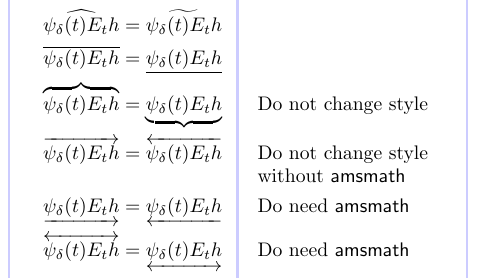

Here, "change style" means that the symbol employed is affected by the math style in use so that it will look right when used, for example, in fractions or subscript/superscript. Those that don't change style will come out right only at the top level of displayed formulas.

## 5.3. Symbols that are vertically extensible

The vertical extensibility is much wider. The following table lists all the symbols that are vertically extensible.

*Vertically extensible symbols*

|||||||
|:---:|---|:---:|---|:---:|---|
| 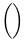 | `(` `)` | 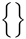 | `\{` `\}` | 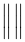 | *`\lVert` `\rVert`* |
| 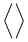 | `\langle` `\rangle` |  | `\lbrace` `\rbrace` | 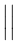 | *`\lvert` `\rvert`* |
| 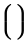 | `\lgroup` `\rgroup` |  | `[` `]` |  | `|` |
| 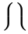 | `\lmoustache` `\rmoustache` |  | `\lbrack` `\rbrack` |  | `\vert` |
|  | `\Downarrow`|  | `\lceil` `\rceil` |  | `\arrowvert` |
| 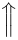 | `\Uparrow` |  | `\lfloor` `\rfloor` |  | `\bracevert` |
|  | `\Updownarrow` | 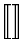 | ***`\llbracket` `\rrbracket`*** |  | `\Arrowvert` |
|  | `\downarrow` |  | `/` |  | `\|` |
| 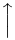 | `\uparrow` |  | `\backslash` |  | `\Vert` |
| 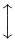 | `\updownarrow` |  | `.` | 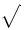 | `\sqrtsign` |

> *Symbols in italics require either the `amsmath` package or, if additionally typed in bold, the `stmaryrd` package. A period (.) is not itself an extensible symbol, but it can be used to produce an "invisible" delimiter. The `\sqrtsign` symbol cannot be used with `\left`, `\right`, or `\middle`.*

> *Synonyms: [ - `\lbrack`, `[`;	] - `\rbrack`, `]`;	{ - `\lbrace`, `\{`;	} - `\rbrace`, `\}`; | - `\vert`, `|`;	|| - `\Vert`, `\|`.*

These symbols become extensible only in certain usages. They must be based on the following construction:

```tex
\left <ext-Open> <sub-formula> \right <ext-Close>
```

> If LaTeX is using the eTeX program, then you can also use these extensible symbols with `\middle`.

Here `<ext-Open>` and `<ext-Close>` can be any of the symbols (except `\sqrtsign`) listed in the table above. They must be symbols that have been set up to be extensible as described in the [fntguide](https://www.latex-project.org/help/documentation/fntguide.pdf). Thus, a symbol representing the absence of an actual glyph must be available. It happened, that this symbol, also known as the *null delimiter*, is the period (.). The sizes of the actual glyphs for typesetting an extensible symbol are chosen to fit with the height and depth of the subformula that lies between them.

The radical symbol `\sqrtsign` grows both vertically and horizontally to fit the size of its argument. In LaTeX, you would rather use the `\sqrt` command to get this symbol.

```tex
\[
  \sqrtsign{1 + \sqrtsign{1 + \sqrtsign{1 +
    \sqrtsign{1 + \sqrtsign{1 + \sqrtsign{1 + x}}}}}}
\]
```

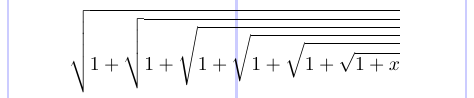