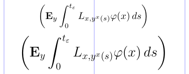
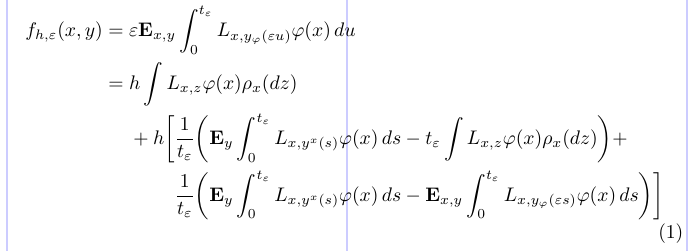
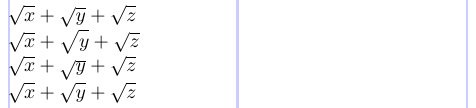
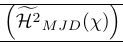
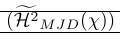
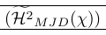
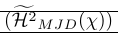
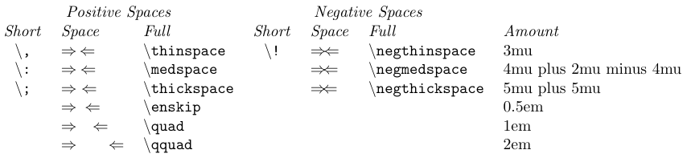
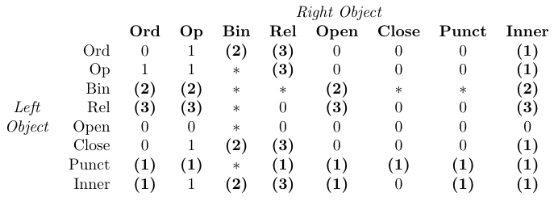

Usually, LaTeX does a great job of laying out math formulas. But sometimes a finer adjustment of the positioning is needed. This article discusses some techniques for fine-tuning the layout to make math formulas a little better.

## 7.1. Automatic sizing and spacing

Math symbols and letters generally get smaller (and with tighter spacing), when they appear in fractions, subscripts, or superscripts. Math formulas can be laid out in eight TeX math styles:

||||
|---|---|---|
| *D, D'* | `\displaystyle`| Displayed on lines by themselves |
| *T, T'* | `\textstyle`| Embedded in text |
| *S, S'* | `\scriptstyle`| In superscripts or subscripts |
| *SS, SS'* | `\scriptscriptstyle`| In all higher-order superscripts or subscripts |

Text style (*T*) is used at the top level of a formula that is set in running text (between a pair of `$` or between `\(` and `\)`), while display style is used at the top level of a displayed formula (between a pair of `$$` or between `\[` and `\]`). As for sub-formulas, style can be determined from the following table:

||||||
|---|---|---|---|---|
| *D* | *S* | *S'* | *T* | *T'* |
| *D'* | *S'* | *S'* | *T'* | *T'* |
| *T* | *S* | *S'* | *S* | *S'* |
| *T'* | *S'* | *S'* | *S'* | *S'* |
| *S, SS* | *SS* | *SS'* | *SS* | *SS'* |
| *S', SS'* | *SS'* | *SS'* | *SS'* | *SS'* |

The next example illustrates the various styles:

```tex
\normalsize                 %% Style:
\[ b                        %% D
    ^0                      %% S
   +                        %% D
   \frac{(k + p)            %% T
          _{j'}             %% S'
         % \displaystyle
         \pm                %% T [D]
         \frac{(f + q)      %% S [T]
                ^{(pk)      %% SS [S]
                   ^y       %% SS
                   _{j'}}}  %% SS'
              {(h + y)}}    %% S' [T']
        {(l + q)            %% T'
          ^{(pk)}}          %% S'
\]
```


You can remove the comment char (`%`) before `\displaystyle` and see how some of the styles have changed to those in brackets:


It shows how to explicitly specify the style to be used in each part.

## 2. Sub-formulas

In text, a pair of braces indicates a group, or a scope, within which some declaration is in effect. Within a math formula, they, in addition, delimit a sub-formula, which is always typeset as a separate entity that is added to the outer formula. As a consequence, sub-formulas are always typeset at their natural width and do not stretch or shrink horizontally when TeX builds a paragraph trying to fit the formula in a line. We have already shown that the sub-formula from a simple brace group is processed as if it was a single symbol. This means that an empty group produces an invisible symbol that can change the spacing.

The contents of subscripts/superscripts and the arguments of many (but not all) commands, such as `\frac` and `\mathrel`, are also sub-formulas. Thus, they get the same special treatment. The argument of `\bm`, for example, is not necessarily set as a sub-formula, and this is one of important exceptions. In a math formula, if you need only to limit the scope of a declaration, define a group using `\begingroup` and `\endgroup`. Remember that specialized math declarations, such as style changes, apply until the end of the current sub-formula, whether or not any other groups are present.

## 3. Big delimiters

LaTeX defines four commands - `\big`, `\Big`, `\bigg`, and `Bigg` - to provide direct control of the sizes of extensible delimiters. They take a single argument, which must be an extensible delimiter, and produce larger versions of the delimiter, from 1.2 to 3 times the base size.

There are also three variants for each of the four commands, giving four sizes of *Opening symbol* (`\bigl`, `\Bigl`, `\biggl`, and `\Biggl`); four sizes of *Relation symbol* (`\bigm`, `\Bigm`, `\biggm`, and `\Biggm`); and four sizes of *Closing symbol* (`\bigr`, `\Bigr`, `\biggr`, and `\Biggr`). All 16 of these commands must be used with any symbol that can come after either `\left`, `\right`, or (with eTeX) `\middle` (see this [table](/tex/java/latex-math-extensible-symbols#53-symbols-that-are-vertically-extensible)). 

The sizes of these delimiters are fixed in standard LaTeX. However, with the `amsmath` package, the sizes adapt to the size of the surrounding material, according to the font size and math style in use. This is shown in the example below.

```tex
\usepackage{amsmath}
% -------------------------------------------------------------------------------
\[ \biggl( \mathbf{E}_{y} \int_0^{t_\varepsilon}
   L_{x, y^x(s)} \varphi(x)\, ds \biggr) \]
\Large
\[ \biggl( \mathbf{E}_{y} \int_0^{t_\varepsilon}
   L_{x, y^x(s)} \varphi(x)\, ds \biggr) \]
```



## 4. Adjusting the index on a radical

The placement of the index on a radical sign is not always good in standard LaTeX. However, you can use the commands `\leftroot` and `\uproot` defined in the `amsmath` package to adjust the positioning of this index. Positive integer arguments to these commands move the index to the left and up, respectively, while negative arguments move it right and down. These arguments are given in math units, which are quite small, so these commands are suitable for fine-tuning.

```tex
\usepackage{amsmath}
% -------------------------------------------------------------------------------
\[
  \sqrt[\beta]{k} \qquad
  \sqrt[\leftroot{2}\uproot{4} \beta]{k} \qquad
  \sqrt[\leftroot{1}\uproot{3} \beta]{k}
\]
```


## 5. Fine-tuning with struts and phantoms

Whenever you want to "perfectly" typeset math spacing and alignment, it is usually best to turn to unique and advanced abilities of primitive TeX. Access to these features is provided by a number of commands related to `\phantom` and `\smash`. Those commands can be used either in math formulas or in running text.

Let's take a look at the following example:

```tex
\usepackage{amsmath}
\newcommand\relphantom[1]{\mathrel{\phantom{#1}}}
\newcommand\ve{\varepsilon} \newcommand\tve{t_{\varepsilon}}
\newcommand\vf{\varphi} \newcommand\yvf{y_{\varphi}}
\newcommand\bfE{\mathbf{E}}
% -------------------------------------------------------------------------------
\begin{equation} \begin{split}
  f_{h, \ve}(x, y)
    &= \ve \bfE_{x, y} \int_0^{\tve} L_{x, \yvf(\ve u)} \vf(x) \,du  \\
    &= h \int L_{x, z} \vf(x) \rho_x(dz)                             \\
    &\relphantom{=} {} + h \biggl[
       \frac{1}{\tve}
       \biggl( \bfE_{y} \int_0^{\tve}  L_{x, y^x(s)} \vf(x) \,ds
               - \tve \int L_{x, z} \vf(x) \rho_x(dz)      \biggr) + \\
    &\relphantom{=} \phantom{{} + h \biggl[ }
       \frac{1}{\tve}
       \biggl( \bfE_{y} \int_0^{\tve}  L_{x, y^x(s)} \vf(x) \,ds
               - \bfE_{x, y} \int_0^{\tve} L_{x, \yvf(\ve s)}
                                            \vf(x) \,ds    \biggr) \biggr]
\end{split} \end{equation}
```



Here, the `\phantom` command gets the horizontal positioning adjusted. In the preamble, it is used to define an invisible relation symbol equal in width to its argument (`=` in this example). Within the math environments, it is used to align certain lines by starting them with a "phantom", or invisible, sub-formula. The empty pair of braces `{}` is the same as `\mathord{}`, which produces an invisible zero-width symbol needed to get the correct spacing of "+ *h*" (without `{}`, the plus sign will produce unary plus with an inappropriate spacing before *h*).

As opposed to `\phantom`, the command `\smash` typesets its contents (in an LR-box) but then ignores both their height and width, as if they were both zero. The command `\hphantom`, defined in standard LaTeX, is a combination of the two. It produces the equivalent of `\smash{\phantom{some phantom contents}}`, i.e. an invisible box with zero height and depth but the width of the phantom contents.

The `\vphantom` command is similar, but it makes the width of the phantom zero preserving its total height plus depth. The command `\mathstrut` is defined as `\vphantom(`, and produces a zero-width box of height and depth equal to that of a parenthesis.

With the `amsmath` package, the `\smash` command can take an optional argument, so that `\smash[t]{...}` ignores the height of the box's contents, keeping the depth, while `\smash[b]{...}` ignores the depth, retaining the height.

```tex
\usepackage{amsmath}
% -------------------------------------------------------------------------------
$\sqrt{x} + \sqrt{y} + \sqrt{z}$ \\
$\sqrt{x} + \sqrt{\mathstrut y} + \sqrt{z}$ \\
$\sqrt{x} + \sqrt{\smash{y}} + \sqrt{z}$ \\
$\sqrt{x} + \sqrt{\smash[b]{y}} + \sqrt{z}$
```



It seems that giving the *y* some extra height with a strut will make the radicals look similar. But, instead, it only makes them look more different, and uglier in whole. It turns out that smashing the bottom of the *y* is the best way.

The following example shows a very common use of smashing. The `\smash` command is used there to provide fine control over the height of surrounding delimiters. It also shows that smashing can cause problems as the real height of the line needs to be known. This is repaired by `\vphantom`. `\Hmjd` is the compound symbol defined as:

```tex
\newcommand\Hmjd{\widetilde{\mathcal{H}^2}_{MJD}(\chi)}
```

To show the resulting vertical space we added rules:

| *Appearance* | `Code` | *Comment* |
|:---:|:---:|---|
|  | `\left( {\Hmjd } \right)` | *Outer brackets too large* |
|  | `\left( \smash{\Hmjd } \right)` | *Outer brackets too small and rules too close* |
|  | `\left( \smash[t]{\Hmjd } \right) \vphantom{\Hmjd}` | *Just right!* |
|  | `\left( \smash[t]{\Hmjd } \right)` | *Both `\vphantom` and partial smash are needed* |

> In a few places, deficiencies in the low-level TeX processing may lead to errors in the fine details of typesetting. This may happen in particular layouts where (a) a sub-formula (numerator/denominator of a fraction or subscript/superscript) consist of exactly one LR-box, or a similarly constructed math box, and also (b) that box doesn't have its natural size, as with the more complex forms of `\makebox`, smashes, and some phantoms.

To see this, let's look at the following example:

```tex
\[
\sqrt{ \frac{a+b}{x_j} } \quad
\sqrt{ \frac{a+b}{\smash{x_j}} } \quad
\sqrt{ \frac{a+b}{{}\smash{x_j}} } \quad
\sqrt{ \frac{a+b}{\smash{x_j+b}} }
\]
```


To reduce the depth of the radical, a `\smash` was added in the second radical, but this had no effect. In the third radical, it worked with an empty brace group.  But in the fourth radical, no empty brace group was needed. To summarize, whenever you find the `\smash` does not work, try adding an empty math sub-formula (`{}`) before the lonely box, to get it treated right.

## 6. Horizontal spacing

Finer, and more difficult, tuning requires the explicit spacing commands shown in the following table:



Both full and short forms of these commands are robust, and they can also be used outside of math formulas in normal text. They are related to thin, medium, and thick spaces available on the machines used to typeset mathematics in the mid-20th century.

The current values of the three TeX parameters `\thinmuskip`, `\medmuskip`, and `\thickmuskip` define the amount of space added by these `\..space` commands. Their default values with `amsmath` are listed in the table. These low-level parameters require values in math units (*mu*). Therefore, they can only be set via low-level TeX assignments, not by `\setlength` or similar. Moreover, normally their values shouldn't be modified since they are used internally by TeX's math typesetting (see the following table).



> In the table, 0 means "no space", 1 means `\thinmuspace`, 2 means `\medmuskip`, 3 means `\thickmuskip`, * means "impossible". Entries set in bold mean that the corresponding spacing is not added in mathematical script styles.

One math unit (`1mu`) is equal to 1/18 of an *em* in the current math font size. It follows that the absolute value of a *mu* varies with a math style, giving consistent spacing regardless of the style used.