Unlike in floating text, you would not generally need automatic changes in font shapes. Different shapes have specific meanings in maths. For example, bold upright letters may be used for vectors. If the characters in a formula were to change due to surrounding conditions, the result would be incorrect. That is why handling of fonts in math formulas differs from that in text.

Characters in a formula can be divided into two classes: symbols and alphabet characters (including digits). Actually, TeX internally deals with eight classes that define appropriate spacing. But for the current discussion, the division into two classes is quite enough.

Some symbols, such as `=`, can be entered directly from the keyboard. However, part of them must be entered via a command, e.g., `\leq` gives a less than or equal sign. The other main group of characters in a formula, the alphabet characters, are entered directly from the keyboard.

There are more than 200 symbols predefined in standard LaTeX. It allows the user to typeset almost any desired formula. These symbols are located in a number of different fonts, but they can be accessed in such a way that the user doesn't have to be aware of how they are represented internally. If necessary, additional symbol fonts can be made accessible in a similar way.

Symbols and alphabet characters have one difference that is most important for us now: symbols have the same graphical representation within one formula, while the user can change the appearance of the alphabet characters. The commands that change the appearance of alphabet characters in a formula are called *math alphabet identifiers*, and the fonts associated with these commands are called *math alphabets*. A formula doesn't change if it is placed, say, inside a theorem environment where text is typeset in italics by default, because the alphabet identifiers are independent of surrounding font commands outside the formula. This behavior is very important because character shapes carry meanings that must remain unchanged wherever the formula appears in a document.

## 8.1. Math alphabet identifiers

One alphabet and a huge number of symbols are not enough for scientists. They try to use every available typeface to denote special concepts. In addition to foreign alphabets such as Greek letters, which usually are accessed as symbols - `\alpha`, `\beta`, etc. - we can find sans serif letters for matrices, bold serif letters for vectors, Fraktur fonts for groups, ideals, or fields. Others use calligraphic shapes to denote sets. The number of conventions is infinite, and they differ from one discipline to another. And LaTeX accommodates this making it possible to declare new math alphabet identifiers and associate them with any desired font shape group instead of relying only on a predefined set that cannot be extended. These identifiers are special commands for use in a formula that typeset any alphabet character in their argument in a specific typeface. These identifiers may use different typefaces in different formulas, as we will see [later](/tex/java/latex-math-fonts/#3-math-formula-versions), but within one formula they always select the same typeface regardless of the surrounding conditions.

### Predefined alphabet identifiers

LaTeX already has a few built-in alphabet identifiers. They are shown in the table below. The last two lines show that the letters used in formulas are taken from the math alphabet `\mathnormal`. On the other hand, the letters produced by `\mathit` have different spacing, which means that this alphabet can be used to provide full-word variable names that are common in some disciplines.

| *Command* | *Example code* | *Result* |
|---|---|---|
| `\mathcal` | `$\mathcal{A}=a$` | 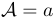 |
| `\mathrm` | `$\mathrm{max}_i$`| 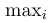 |
| `\mathbf` | `$\sum x = \mathbf{v}$`| 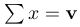 |
| `\mathsf` | `$\mathsf{G}_1^2$`| 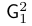 |
| `\mathtt` | `$\mathtt{W}(a)$`| 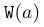 |
| `\mathnormal` | `$\mathnormal{abc}=abc$`| 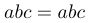 |
| `\mathit` | `$differ\neq\mathit{differ}$`| 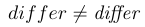 |

In LaTeX2e, math alphabet identifiers are commands with one argument, a single letter or a single word to be typeset in a special font.


```tex
Therefore, $\mathsf{G}$ can be computed as
\begin{equation}
\mathsf{G} = \mathcal{A} +
             \sum_{i=1}^{n} \mathcal{B}_{i}
\end{equation}
```

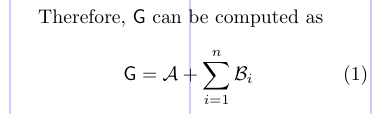

***Default math alphabet***

If you don't specify an alphabet identifier explicitly, from which alphabet are the alphabet characters selected? In other words, what is the default math alphabet? The answer is that there is no single default math alphabet. The LaTeX system can be set up so that alphabetical characters are fetched from different alphabets, unless the user explicitly asks a specific one, and this is normally the case, as the following example shows.

```tex
\begin{eqnarray}
x &=& 12345 \\
\mathrm{x} &=& \mathrm{12345} \\
\mathnormal{x} &=& \mathnormal{12345}
\end{eqnarray}
```

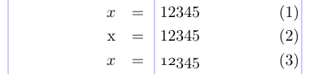

Here you can see that `\mathrm` doesn't change the digits and `\mathnormal` doesn't change the letters, so the default for digits in the normal set-up is the math alphabet associated with `\mathrm` and the default for letters is the one associated with `\mathnormal`. This behavior can be controlled with the `\DeclareMathSymbol` command.


### Custom alphabet identifiers

You can use the `\DeclareMathAlphabet` command to define a new math alphabet identifier. Let's say that you want to make a slanted sans serif typeface available as a math alphabet. First you decide on a new command name, such as `\msfsl`, to be used as the alphabet identifier. Then you refer to the font classification table below to find a suitable font shape group to assign to this alphabet identifier.

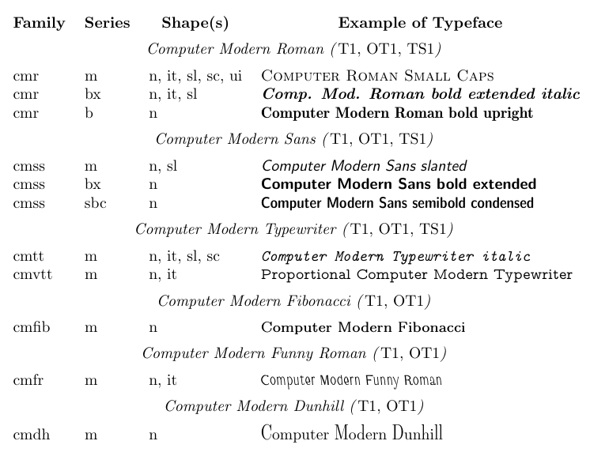

You will find that the **Computer Modern Sans** family, for example, consists of a medium series with upright and slanted shapes. If you decide to use the slanted shape of this family, you tell LaTeX using `\DeclareMathAlphabet`.

```text
\DeclareMathAlphabet{cmd}{encoding}{family}{series}{shape}
```

There are four parameters (besides the identifier itself) in the declaration: the encoding name, the family, the series, and the shape of the font to be used. The alphabet identifier defined in the following example will always switch to **Computer Modern Sans** medium slanted.

```tex
\DeclareMathAlphabet{\msfsl}{OT1}{cmss}{m}{sl}
% -------------------------------------------------------------------------------
We demonstrate this with the formula
\begin{equation}
\sum \msfsl{A}_{i} = a \tan \beta
\end{equation}
```

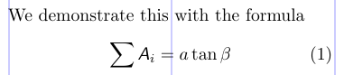

You can also redefine an existing math alphabet identifier in a package file or in the preamble of your document. For example,

```tex
\DeclareMathAlphabet{\mathsf}{OT1}{pag}{m}{n}
```

will override the default settings for the `\mathsf` alphabet identifier. It will switch to **Adobe Avant Garde** in your formulas.

> Note that if the math alphabet in question is part of a symbol font that is already loaded by LaTeX for other reasons (e.g., `\mathcal`), it is better to use `\DeclareSymbolFontAlphabet` as it makes better use of TeX's somewhat limited resources for math.

## 8.2. Text font commands in math

Although text font declarations like `\rmfamily` cannot be used in math, the font-changing commands - e.g., `\textrm` - can be used in both text and math. Using these commands, you can temporarily switch from math to text context and typeset some text in the middle of your formula that logically is part of the surrounding text outside the formula. The font used to typeset this text will depend on surrounding conditions, which means it will inherit the current encoding, family, series, and shape, as in the example below.

```tex
\sffamily The result will be
\[ x = 10 \textbf{ and thus } y = 12 \]
```

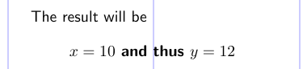

Here we can see that the **Sans** family was retained and the series was changed to bold. The [`\text`](/tex/java/latex-text-in-math-formula/#61-the-text-command) command provided by the `amstext` package (which is also loaded by `amsmath`) may turn out to be more useful. It picks up the current encoding, family, series, and shape values without changing any of them.

## 8.3. Math formula versions

We have discussed how to change parts of a formula using math alphabet identifiers. LaTeX also allows you to change the appearance of a formula as a whole. Math formulas are always typeset in a certain *math version*. And you can switch between math versions outside of math mode by using the command `\mathversion`, which changes the overall layout of the following formulas.

LaTeX has two math versions by default: *normal* and *bold*. And special packages provide more versions. For example, the *mathtime* package (for the commercial **MathTime** fonts) sets up a math version called *heavy* to typeset formulas with ultra bold symbols as provided by the **MathTime** fonts.

Obviously, the default math version is `\mathversion{normal}`. The bold version, in turn, will produce bolder alphabet characters and symbols, though big operators, like `\sum`, are not changed by default. The example below shows the same formula first in the normal and then in the bold math version.

```tex
\begin{equation}
  \sum_{j=1}^{z} j = \frac{z(z+1)}{2}
\end{equation}
\mathversion{bold}
\begin{equation}
  \sum_{j=1}^{z} j = \frac{z(z+1)}{2}
\end{equation}
```

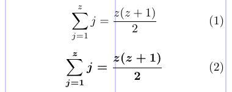

Using `\mathversion` may be suitable in certain situations, such as in headings, but you have to keep in mind that changing the version means changing the appearance and possibly the meaning of the entire formula. If you want to darken only some symbols or characters within one formula, you should use the `\mathbf` alphabet identifier for characters and/or use the `\bm` command provided by the [`bm`](/tex/java/latex-math-fonts/#5-bold-face-in-formulas-the-bm-package) package rather than change the `\mathversion`.

When you change the math version, LaTeX looks in its internal tables to find where all the symbols for this new math version are located. It may also change all or some of the math alphabet identifiers and associate them with other font shapes in this version.

But what happens to custom alphabet identifiers like `\msfsl` which we defined in the [example](/tex/java/latex-math-fonts/#custom-alphabet-identifiers)? As long as you declared them using `\DeclareMathAlphabet`, they will remain the same in all math versions.

If the math alphabet identifier is to produce a different font in a special math version, you must tell LaTeX about it by using the `\SetMathAlphabet` command. For example, in the default set-up the `\mathsf` alphabet identifier is defined as follows:

```tex
\DeclareMathAlphabet{\mathsf}{OT1}{cmss}{m}{n}
\SetMathAlphabet{\mathsf}{bold}{OT1}{cmss}{bx}{n}
```

The first line sets **Computer Modern Sans** medium as the default for `\mathsf` in all math versions. The second line instructs LaTeX to use **Computer Modern Sans** bold extended in the bold math version.

```tex
\SetMathAlphabet{cmd}{version}{encoding}{family}{series}{shape}
```

As you might have guessed from the previous example, `\SetMathAlphabet` takes six arguments: the math alphabet identifier, the math version name for which you are defining a special set-up, and four parameters to identify the font with which you are associating your set-up.

As we noted earlier, you can redefine an existing math alphabet identifier by using `\DeclareMathAlphabet`. If you do so, all previous `\SetMathAlphabet` declarations for this identifier are removed from the internal memory of LaTeX. So the identifier will come out the same in all math versions unless you add new `\SetMathAlphabet` declarations for it.

## 8.4. Tuning fonts in formulas with AMS-LATEX packages

The *amsfonts* (and *amssymb*) package defines two math alphabets: the Euler Fraktur alphabet (`\mathfrak`) and the Blackboard Bold alphabet (`\mathbb`). See the example below.

```tex
\usepackage{amsfonts}
% -------------------------------------------------------------------------------
$ \forall n \in \mathbb{N} : \mathfrak{M}_n \leq \mathfrak{A} $
```

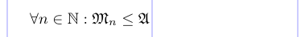

## 5. Bold type face in formulas. The `bm` package

For Latin letters only, you can use the `\mathbf` command. For everything else, there is the `bm` package. Just load it and use `\bm` to make any formula as bold and beautiful as the available fonts allow.

The following example shows many ways to use `\bm` and `\mathbf` commands. It also shows a strategy for defining shorthand names for frequently occurring bold symbols, using both standard LaTeX's `\newcommand` and `\bmdefine`, which is provided by the `bm` package. Note that `\mathbf{xy}` is not identical to `\bm{xy}`. The former produces bold Roman "**xy**" and the latter produces "***xy***" (bold math italic).

```tex
\usepackage{amsmath,amssymb,bm}
\newcommand\bfB{\mathbf{B}} \newcommand\bfx{\mathbf{x}}
\bmdefine\bpi{\pi} \bmdefine\binfty{\infty}
% -------------------------------------------------------------------------------
\section{The bold equivalence
  $\sum_{j < B} \prod_\lambda : \bm{\sum_{x_j} \prod_\lambda}$}
\begin{gather}
  B_\infty + \pi B_1 \sim \bfB_{\binfty} \bm{+} \bpi \bfB_{\bm{1}}
    \bm {\sim B_\infty + \pi B_1}\\
  B_\binfty + \bpi B_{\bm{1}} \bm{\in} \bm{\biggl\lbrace}
    (\bfB, \bfx) : \frac {\partial \bfB}{\partial\bfx}
    \bm{\lnapprox} \bm{1} \bm{\biggr\rbrace}
\end{gather}
```

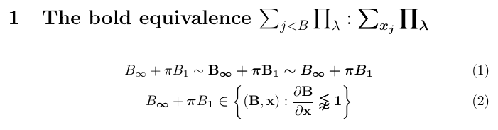

In this example `bm` tries its best to fulfill the requests for bold versions of individual symbols and letters. But if you look closely, you will see that the results are not always optimal. For example, the sum and product operators are made with a technique known as *poor man's bold*, in which the symbol is overprinted three times with slight offsets. Also, the curly brackets are not made bold at all. Such drawbacks cannot be avoided because for some symbols there is simply no bold variant when using the **Computer Modern** math fonts.

What are the exact rules that `\bm` follows to produce bold forms of the symbols in its argument? In general, it uses the fact that LaTeX includes a **bold** math version (accessible via `\boldmath`) for typesetting a whole formula in bold (provided suitable bold fonts are available and set up). For each symbol, the `\bm` command looks at this math version to see what would be done in that version. If the font selected for the symbol is different from the one selected in the normal math version, it then typesets the symbol in this bold font, obtaining a perfect result (assuming that the bold math version was set up properly). If the fonts in both versions are identical, it assumes that there is no bold variant available and applies poor man's bold.

> Load the `bm` package after packages that change the existing math font set-up!

The situation is even more complex with delimiters, such as `\biggl\lbrace` in the example. TeX typically typesets a delimiter by a glyph chosen to match a requested height from a sequence of different sizes. These glyphs can be located in different fonts, and a particular size may or may not have bold variants. All of this together makes it impossible for `\bm` to reliably determine whether it needs to apply poor man's bold. It therefore typesets the delimiter using whatever fonts are offered by the bold math version. With the **Computer Modern** math fonts, only the smallest delimiter size is available in bold; all other sizes come from fonts that have no bold variants.

```tex
\usepackage{bm}
% -------------------------------------------------------------------------------
$\bm{\Biggl\lbrace\biggl\lbrace\Bigl\lbrace\bigl \lbrace \lbrace
  \mathcal{Q}
  \rangle \bigr\rangle\Bigr\rangle\biggr\rangle
\Biggr\rangle}$
```

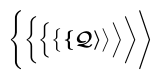

Normally, if a command that itself takes arguments is within the `\bm`'s argument, then that command must be fully included in the argument of `\bm`. As a result, all parts of the typeset material will be in bold. If you need the output of a command with arguments to be only partially bold, then you should do the following. You should put the symbol(s) that you don't want to be bold in an `\mbox` and explicitly reset the math version within the box contents using `\unboldmath`. TeX considers an `\mbox` to be a symbol of class *Ordinary*. Thus, to get the spacing right, you may have to surround it by a `\mathbin`, `\mathrel`, or `\mathop`.

```tex
\usepackage{amsmath,bm}
% -------------------------------------------------------------------------------
$ \bm{\sqrt[2]{x \times \alpha}} $ but
$ \bm{\sqrt[2]{x \mathbin{\mbox{\unboldmath$\times$}} \alpha}} $
or the similar
$ \bm{\sqrtsign}{\bm{x} \times \bm{\alpha}} $
```

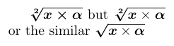

Fortunately, such complex operations are rarely required. In most cases involving commands with arguments, only parts of the argument need to be made bold. And this can be achieved by using the `\bm` command inside those arguments. As with `\sqrtsign` in the previous example, for the common case of bold accents, `\bm` is specially programmed to allow the accent's argument to be outside its own argument. However, if you need such accents regularly, it is best to define your own abbreviations, as in the example below.

***Improving the performance***

Although `\bmdefine\bpi{\pi}` appears to be simply shorthand for `\newcommand\bpi{\bm{\pi}}`, in fact the truth is almost the opposite: `\bm` defines a new hidden temporary command using `\bmdefine` and then immediately uses this temporary command to produce the bold symbol. In other words, `\bmdefine` does all the hard work! If you frequently use, for example, something that is defined via `\bm{\alpha}`, then a new `\bmdefine` is executed every time. If you provide the `\bmdefine\balpha{\alpha}` definition in the preamble, then `\bmdefine` does its time-consuming work only once, no matter how many times `\balpha` is used.

```tex
\usepackage{bm}
\bmdefine\bhat{\hat}
% -------------------------------------------------------------------------------
$\hat a \neq \bm{\hat a} \neq \bm\hat a = \bhat a\neq \bm\widehat a$
```

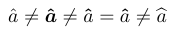

This example also shows that the variable-width accents (e.g., `\widehat`) share a deficiency with the delimiters: in the **Computer Modern** math set-up they come from a font for which no bold variant is available.