The tables in this article list the large range of math symbols provided by the AMS-LATEX packages, including commands to access each symbol. They also include the supplementary symbols from the **St Mary Road** font designed by Allan Jeffrey and Jeremy Gibbons. This package extends **Computer Modern** and AMS symbol font collections and should normally be loaded in addition to `amssymb`, but always after it. It provides extra symbols for fields such as functional programming, process algebra, domain theory, linear logic and many more.

The tables indicate which extra packages need to be loaded to use each symbol command. Symbols with command names in black are available in standard LaTeX. Symbols with command names in blue require loading either `amsmath`, `amssymb`, or `stmaryrd`. If nesessary, further classification is given by markings: <sup>(*StM*)</sup> means a symbol from `stmaryrd` when the table also contains symbols from other packages; <sup>(*kernel*)</sup> marks symbols that are available in standard LaTeX but only by combining two or more glyphs, whereas a single glyph exists in the indicated package; and <sup>(*var*)</sup> marks "Alphabetic symbols" (of type `\mathalpha`) that change appearance when used within the scope of a [math alphabet identifier](/tex/java/latex-math-fonts/#1-math-alphabet-identifiers).

## 9.1. Math symbol classes

The primary classification of math symbols is related to their meaning in technical usage. In math typography, this classification defines the formula layout. In particular, TeX's math formatter adjusts the horizontal space on either side of each symbol according to its mathematical class. This classification also makes some finer distinctions, for example, between accents and simple symbols and in breaking the enormous list of *Relation* symbols into several tables.

The set-up for mathematics puts each symbol into one of these clases: *Ordinary* (Ord), *Operator* (Op), *Binary* (Bin), *Relation* (Rel), *Opening* (Open), *Closing* (Close), or *Punctuation* (Punct). The symbol's class can be explicitly changed by using the commands `\mathord`, `\mathop`, `\mathbin`, `\mathrel`, `\mathopen`, `\mathopen`, and `\mathpunct`. In the next example, `\#` and `\top` (both Ord by default) are changed into a Rel and an Op.

```tex
\usepackage[fleqn]{amsmath}
\[ a \# \top _x^\alpha x^\alpha_b \]
\[ a \mathrel{\#} \mathop{\top}_x^\alpha x^\alpha_b \]
```

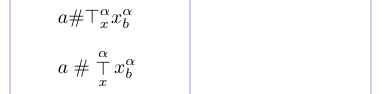

In addition to the above classes, certain subformulas - most importantly fractions, and those produced by `\left` and `\right` - form a class called *Inner*, which is explicitly available via the `\mathinner` command.

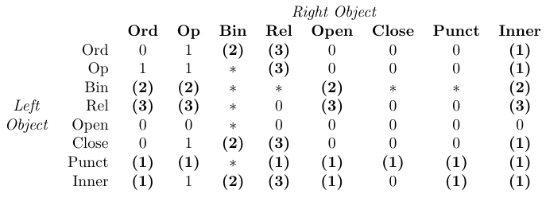

> In the table, "0" means "no space", "1" means `\thinmuspace`, "2" means `\medmuskip`, "3" means `\thickmuskip`, "*" means "impossible". Entries set in bold mean that the corresponding spacing is not added in mathematical script styles.

TeX handles spacing within formulas simply by identifying the class of each object in a formula and then adding space between each pair of adjacent objects as defined by the previous table. This table is hard-coded into TeX's math typesetting routines and thus cannot be changed by macro packages.

A *Binary* symbol is turned into an *Ordinary* symbol whenever it is not preceded and followed by symbols of a nature compatible with a binary operation. That is why some entries in the table are marked as impossible. For example, `$+x$` gives +*x* (a unary plus) and not + *x*. The latter can be produced by `${}+x$`.

Consider the following formula (the default values are changed to show the added spaces more clearly):

```tex
thinmuskip=10mu \medmuskip=17mu \thickmuskip=30mu
% -------------------------------------------------------------------------------
\[
a - b = -\max \{ x , y \}
\]
```

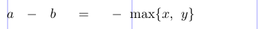

TeX identifies the objects as Ord, Bin, Ord, and so on, and then inserts spaces as follows:

```
 A      -      b      =      -    \max   \{   x    ,       y   \}
Ord \: Bin \: Ord \; Rel \; Ord \, Op   Open Ord Punct \, Ord Close
```

The minus in front of `\max` is turned into an *Ordinary* because a *Binary* cannot follow a *Relation*.

In a "`\left...\right`" construction, the entire subformula delimited by the construction becomes a single object of class *Inner*. In contrast, commands like `\Bigl` and `\Bigr` produce individual symbols of the classes *Opening* and *Closing*, respectively. The difference between them is revealed in the spacing table above. Although they may result in delimiters of equal vertical size, spacing differences can arise depending on adjacent objects in the formula. For example, *Ordinary* followed by *Opening* gets no space, whereas *Ordinary* followed by *Inner* is separated by a thin space. The spaces inside the subformula within a "`\left...\right`" construction are made as expected, beginning with an *Opening* symbol and ending with a *Closing* symbol.

```tex
\thinmuskip=10mu \medmuskip=17mu \thickmuskip=30mu
% -------------------------------------------------------------------------------
\[ a \Bigl( \sum x \Bigr) \neq a \left( \sum x \right) \]
```

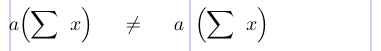

In summary, it's better to check that a symbol belongs to the desired class, rather than just look it up in the tables that follow.

## 9.2. Letters, numerals, and other *Ordinary* symbols

The unaccented ASCII Latin letters and Arabic numeral digits are all referred to as "Alphabetic symbols". The font they are typed in can vary. In math formulas, the default font for Latin letters is italic, whereas for the Arabic digits it is upright/Roman. Alphabetical symbols are all of class *Ordinary*.

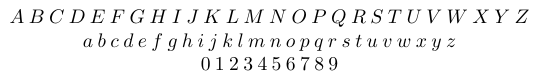

Unlike the Latin letters, the mathematical Greek letters are no longer closely related to the glyphs used for typesetting normal Greek text. Due to a curious 18th-century happenstance, in the major European tradition of math typography the default font for lowercase Greek letters in math formulas is italic whereas for uppercase Greek letters it is upright/Roman. (In physics and chemistry, for example, the typographical traditions are slightly different.)

The capital Greek letters in the first rows of the following table are also Alphabetic symbols whose font varies, with the default being upright/Roman. There are capital Greek letters, each of which has the same appearance as some Latin letter (e.g., *A* and *Alpha*, *B* and *Beta*, *K* and *Kappa*, *O* and *Omicron*). These letters are not present in the table. For the same reason, there is no lowercase omicron. In practice, the Greek letters that look like Latin letters are not used in math formulas.

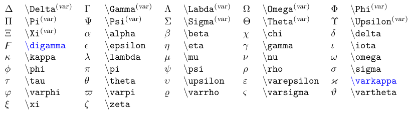

> Symbols in blue require the `amssymb` package. <sup>(*var*)</sup> indicates a variable Alphabetic symbol.

The next table lists other letter-shaped symbols of class *Ordinary*. The first four are Hebrew letters.

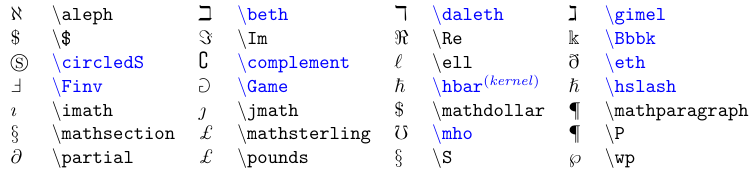

> Symbols in blue require the `amssymb` package.

The next table lists the remaining symbols in the *Ordinary* class, including some common punctuation. These behave like letters and digits, so they never get any extra space around them.

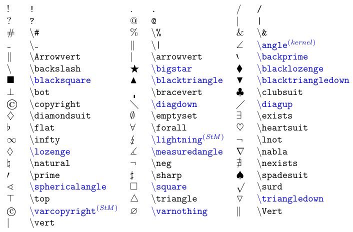

> Symbols in blue require either the `amssymb` package or, if flagged with <sup>(*StM*)</sup>, the `stmaryrd` package.

> Note that the exclamation sign, period, and question mark are not treated as punctuation in formulas.

> Synonyms: logical negation - `\lnot`, `\neg`; `|` - `\vert`, `|`; `||` - `\Vert`, `\|`.

A common mistake is to use these symbols directly as *Binary* operators or *Relation* symbols, without using a properly defined math symbol command for that type. Thus, if you use commands such as `\#`, `\square`, or `\&`, check carefully that you get the correct inter-symbol spaces or, even better, define your own symbol command.

```tex
\usepackage[fleqn]{amsmath} \usepackage{amssymb}
\DeclareMathSymbol\bneg {\mathbin}{symbols}{"3A}
\DeclareMathSymbol\rsquare{\mathrel}{AMSa}{"03}
% -------------------------------------------------------------------------------
\[ a \neg b \qquad x \square y + z \]
\[ a \mathbin{\neg} b \qquad x \mathrel{\square} y + z \]
\[ a \bneg b \qquad x \rsquare y + z \]
```

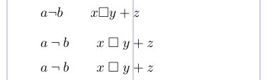

The `\DeclareMathSymbol` command is used to declare your own symbol name.

```tex
\DeclareMathSymbol{cmd}{type}{symbol-font}{slot}
```

The first argument is your chosen command name. The second argument is one of the commands corresponding to the symbol class. The third argument identifies the symbol font from which the symbol should be fetched. The fourth argument gives the symbol's position in the font encoding, either a decimal, octal, or hexadecimal value. The correct values for the arguments could be most easily found by looking at the definitions in the file `amssymb.sty` or `fontmath.ltx` (for the core symbols). For example, we looked up `\neq` and `\square`, replaced the `\mathord` in each case, and finally gave the resulting symbol a new name.

## 9.3. Math accents

The table below lists the accent commands available in formulas. Most of them are defined in standard TeX. See [here](/tex/java/latex-math-extensible-symbols/#52-symbols-that-are-horizontally-extensible) for information about extensible accents. When you add a math accent to a symbol, the result is a symbol of class *Ordinary*.

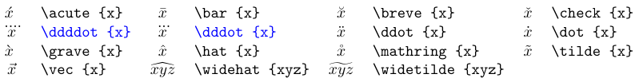

> Accents in blue require the `amsmath` package.

> The last two accents are available in a range of widths, the largest suitable one being automatically used.

```tex
\usepackage{amstext}
% -------------------------------------------------------------------------------
\[ a = b \text{ but } a \tilde{=} b
\text{ which is not } a \mathrel{\tilde{=}} b \]
```

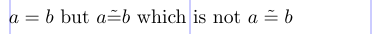

Other ways to place symbols over *Relation* symbols are shown [here](/tex/java/latex-math-decorations/#47-other-decorations). When adding an accent to an *i* or *j* in math formulas, it's best to use the dotless variants `\imath` and `\jmath`.

## 9.4. *Binary* operator symbols

There are more than 100 symbols of class *Binary* from which to choose. Most of them are listed in the following table. Some of them are also available as *Relation* symbols, although under different names.

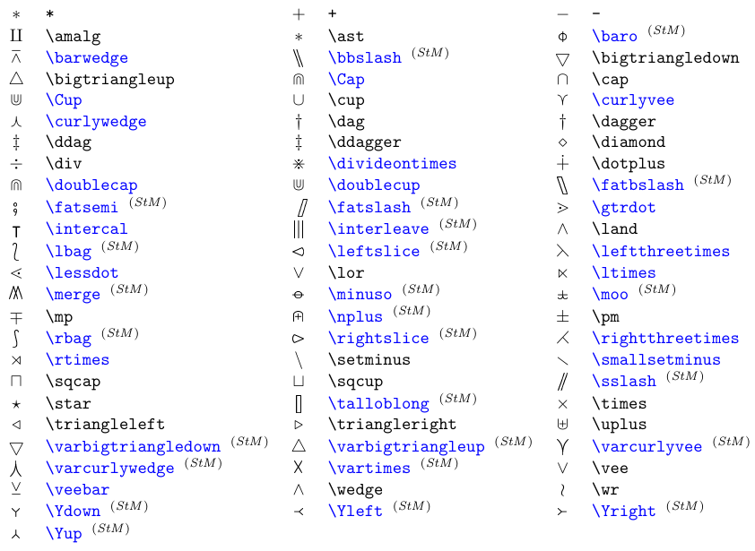

> Symbols in blue require either the `amssymb` package or, if flagged with <sup>(*StM*)</sup>, the `stmaryrd` package.

> The left and right triangles are also available as *Relation* symbols.

> The `stmaryrd` package confusingly changes the *Binary* symbols `\bigtriangleup` and `\bigtriangledown` into *Operators*, leaving only the synonyms `\varbigtriangleup` and `\varbigtriangledown` for the *Binary* operator forms.

The `amssymb` package offers a few box symbols for use as *Binary* operators; many more are added by `stmaryrd`. See the next table.

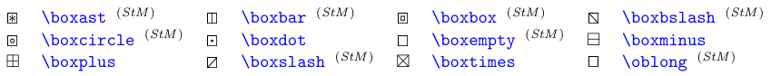

> All symbols require either the `amssymb` package or, if flagged with <sup>(*StM*)</sup>, `the stmaryrd` package.

You can load the `stmaryrd` package with the option `heavycircles`. As a result, each circle symbol command from the next table that starts with `\var` swaps its definition with the corresponding command without the "var"; for example, the symbol `\varodot` becomes `\odot`, and vice versa.

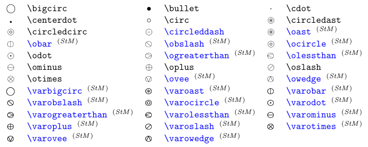

> Symbols in blue require either the `amssymb` package or, if flagged with <sup>(*StM*)</sup>, the `stmaryrd` package.

> Option `heavycircles` of the `stmaryrd` package affects all commands starting with `\var` and their normal variants.

## 9.5. Relation symbols

The class of binary *Relation* symbols is even large than that of the *Binary* operators. The next table lists symbols for equality and order. A slash can be put through any *Relation* symbol by preceding it with the `\not` command. The negated symbol represents the complement (or negation) of the relations.

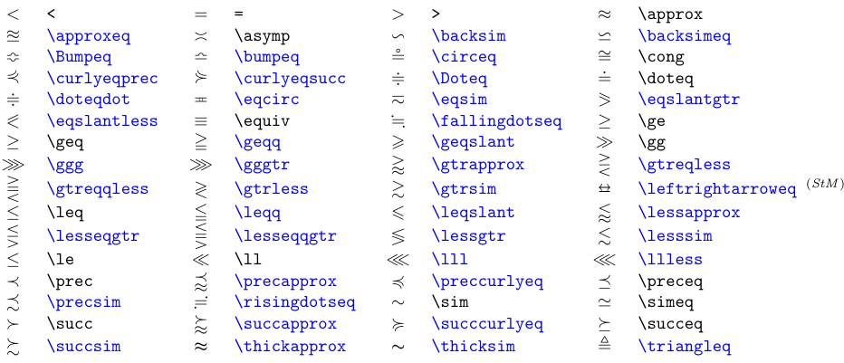

> Symbols in blue require either the `amssymb` package or, if flagged <sup>(*StM*)</sup>, the `stmaryrd` package.

```tex
$ u \not< v$ or $a \not\in \mathbf{A} $
```

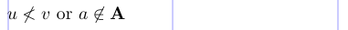

This generic method of negating a *Relation* symbol doesn't always give good results, especially with larger symbols, because the slash will always be of the same size, position, and slope. Due to this fact, some specially designed "negated symbols" are also available. See the list in the next table.

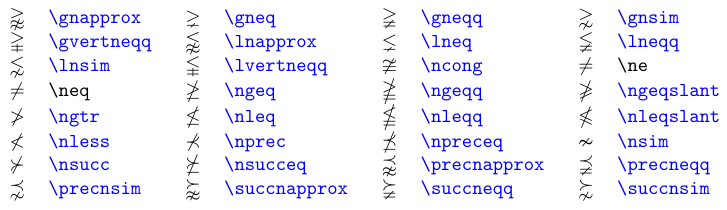

> Symbols in blue require the `amssymb` package.

If a choice is available, it is usually preferable to use the specially designed glyphs. To see why, compare the symbols in the next example.

```tex
\usepackage{amssymb}
% -------------------------------------------------------------------------------
$ \not\leq \ \not\succeq \ \not\sim $ \par
$ \nleq \ \nsucceq \ \nsim $
```

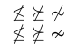

The next table lists the *Relation* symbols for sets and inclusions.

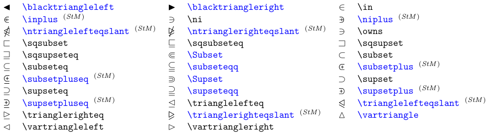

> Symbols in blue require either the `amssymb` package or, if flagged with <sup>(*StM*)</sup>, the `stmaryrd` package.

And now negations of the *Relation* symbols for sets and inclusion.

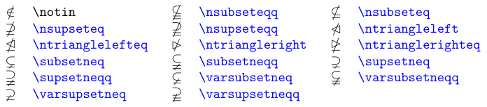

> Symbols in blue require the `amssymb` package.

The next table lists the arrow-shaped *Relation* symbols. Some extensible arrow constructions that produce compound *Relation* symbols are described [here](/tex/java/latex-math-extensible-symbols/#52-symbols-that-are-horizontally-extensible).

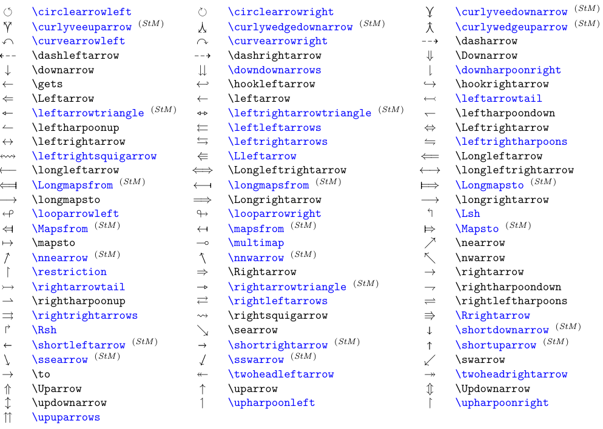

> Symbols in blue require either the `amssymb` package or, if flagged with <sup>(*StM*)</sup>, the `stmaryrd` package.

And here are the negated arrow-shaped *Relation* symbols.

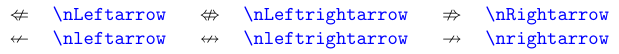

> Symbols in blue require the `amssymb` package.

There are other elements (in addition to `\not` used to negate general *Relation* symbols) that were specially designed to negate or extend arrow-like symbols. See the next table.

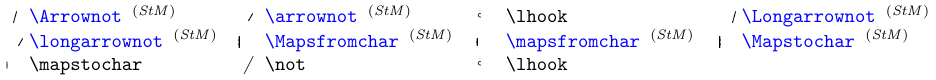

> Symbols in blue require the `stmaryrd` package.

> These symbols are for combining, mostly with arrows; e.g., `\longarrownot\longleftarrow`.

> Use `\joinrel` to "glue" relational symbols together, e.g., `\lhook\joinrel\longrightarrow`.

> The dimensions of these symbols make them unsuitable for other uses.

```tex
\usepackage{stmaryrd}
% -------------------------------------------------------------------------------
$\Longarrownot\longleftrightarrow \qquad \arrownot \hookleftarrow$
```

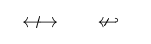

Finally, below are other miscellaneous *Relation* symbols.

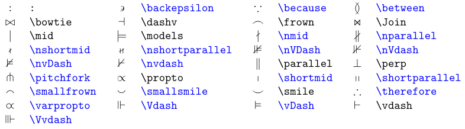

> *Relation* symbols in blue require the `amssymb` package.

> `\therefore` is a *Relation* symbol, so its spacing may not be as expected in common uses.
