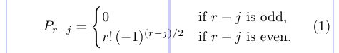
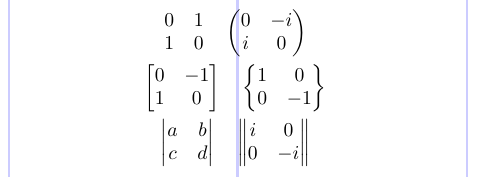
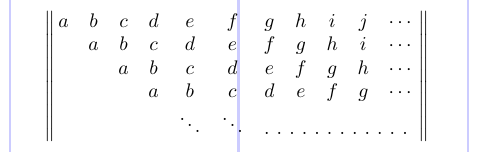
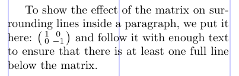
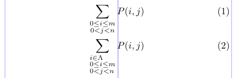
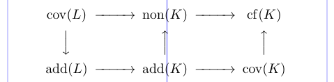
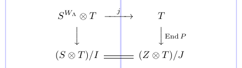
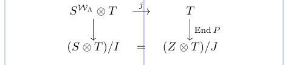
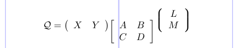

There are a number of environments for typesetting matrix-like structures defined in the `amsmath` package. They are all similar to the standard LaTeX `array` environment in syntax and layout. In general, a wide variety of two-dimensional mathematical structures and tabular layouts can be described as arrays.

Three environments - `cases`, `matrix` and `pmatrix` - replace the commands of standard LaTeX. The standard commands use a different notation so they can't be used together with the environment forms discussed here. The `amsmath` package will produce an error message if one of the old commands is used. Conversely, if you try to use the `amsmath` environment forms without loading the package, you will most likely get the following error message: `"Misplaced alignment tab character &"`.


## 3.1. The `cases` environment

The `case` environment is used to handle constructions, where a single equation has a few variants. Such constructions are very common in maths. It produces an array with two columns, both left-aligned.

```tex
\usepackage{amsmath}
% -------------------------------------------------------------------------------
\begin{equation}
P_{r - j} = \begin{cases}
                     0 & \text{if $r - j$ is odd,} \\
r! \, (-1)^{(r - j)/2} & \text{if $r - j$ is even.}
\end{cases}
\end{equation}
```



Notice the use of the `\text` command and the "embedded math mode" in the text strings.

## 3.2. The matrix environments

The matrix environments, unlike LaTeX's `array`, don't accept an argument that specifies the formats of the columns. Instead, they provide a default format: up to 10 centered columns. The spacing also slightly differs from the default in `array`. The following examples illustrate the `matrix`, `pmatrix`, `bmatrix`, `Bmatrix`, `vmatrix` and `Vmatrix` environments.

```tex
\usepackage{amsmath}
% -------------------------------------------------------------------------------
\begin{gather*}
\begin{matrix} 0 & 1 \\ 1 & 0 \end{matrix} \quad \begin{pmatrix} 0 & -i \\ i & 0 \end{pmatrix} \\
\begin{bmatrix} 0 & -1 \\ 1 & 0 \end{bmatrix} \quad \begin{Bmatrix} 1 & 0 \\ 0 & -1 \end{Bmatrix} \\
\begin{vmatrix} a & b \\ c & d \end{vmatrix} \quad \begin{Vmatrix} i & 0 \\ 0 & -i \end{Vmatrix}
\end{gather*}
```



The `MaxMatrixCols` counter determines the maximum number of columns in a matrix environment. You can change it using LaTeX's standard counter command. The value of the `\arraycolsep` length parameter determines the amount of space between the columns. Just like in standard arrays, but no space is added on either side of array. More columns will make LaTeX work harder and require more resources. However, setting `MaxMatrixCols` to 20 or higher is possible without a noticeable performance hit, since with today's typical TeX implementations such limits are less important.

```tex
\usepackage{amsmath}
\setcounter{MaxMatrixCols}{20}
% -------------------------------------------------------------------------------
\[
\begin{Vmatrix}
\,a&b&c&d&e&f&g&h&i&j &\cdots\,{} \\
&a&b&c&d&e&f&g&h&i &\cdots\,{} \\
& &a&b&c&d&e&f&g&h &\cdots\,{} \\
& & &a&b&c&d&e&f&g &\cdots\,{} \\
& & & &\ddots&\ddots&\hdotsfor[2]{5}\,{}
\end{Vmatrix} \]
```



In this example the `\hdotsfor` command is used to produce a row of dots in a matrix, spanning a given number of columns. The optional parameter (here 2) may be used to specify a multiplier for the default space (3 math units) between the dots. The thin space and the brace group `\,{}` at the end of each row simply make the layout look better; together they produce two thin spaces, about 6mu or 1/3em.

To produce a small inline matrix for use in text, you can use the `smallmatrix` environment.

```tex
\usepackage{amsmath}
% -------------------------------------------------------------------------------
To show the effect of the matrix on surrounding lines inside a paragraph, we put it here:
$ \left( \begin{smallmatrix}
1 & 0 \\ 0 & -1
\end{smallmatrix} \right) $
and follow it with enough text to ensure that there is at least one full line below the matrix.
```



Note that the text lines are not spread apart even though the line before the small matrix contains letters with descenders.

## 3.3. Stacking in subscripts and superscripts

Sometimes you may need to typeset several lines within a subscript or superscript. To do this, you can use the `\substack` command with `\\` delimiting rows.

The `subarray` environment is a slightly more general structure that allows you to align lines to the left or right, rather than have them centered.

```tex
\usepackage{amsmath}
% -------------------------------------------------------------------------------
\begin{gather}
\sum_{\substack{0 \le i \le m \\ 0 < j < n}} P(i, j) \\
\sum_{\begin{subarray}{l}
i \in \Lambda \\
0 \le i \le m \\
0 < j < n
\end{subarray}} P(i, j)
\end{gather}
```



> Note that both environments need to be surrounded by braces when they appear as a subscript or a superscript.

## 3.4. Commutative diagrams

The `amscd` package defines some commands for producing simple commutative diagrams based on arrays. There are some useful shorthand forms for specifying decorated arrows and other connectors. However, it has limitations - for example, these connectors can be only horizontal or vertical.

In the `CD` environment, the notations `@>>>`, `@<<<`, `@VVV`, and `@AAA` produce right, left, down and up arrows, respectively. The following example also shows the use of the `\DeclareMathOperator` command.

```tex
\usepackage{amsmath,amscd}
\DeclareMathOperator\add{add}
\DeclareMathOperator\cf {cf}
\DeclareMathOperator\cov{cov}
\DeclareMathOperator\non{non}
% -------------------------------------------------------------------------------
\[ \begin{CD}
\cov (L) @>>> \non (K) @>>> \cf (K) \\
@VVV @AAA @AAA \\
\add (L) @>>> \add (K) @>>> \cov (K) \\
\end{CD} \]
```



Let's see how decorations are specified. For the horizontal arrows, material between the first and second `>` or `<` symbols will be typeset as a superscript, and material between the second and third will be typeset as a subscript. Similarly, material between the first and second, or second and third, `A`'s or `V`'s of vertical arrows will be typeset as left or right "side-script". We will see the use of this format in the next example.

The notations `@=` and `@|` give horizontal and vertical double lines.

Instead of a visible arrow, you can use a "null arrow" (`@.`) to fill out an array where needed.

```tex
\usepackage{amsmath, amscd}
\DeclareMathOperator{\End}{End}
% -------------------------------------------------------------------------------
\[ \begin{CD}
S^{W_\Lambda}\otimes T @>j>> T \\
@VVV @VV{\End P}V \\
(S \otimes T)/I @= (Z\otimes T)/J
\end{CD} \]

```



A similar layout can be produced in standard LaTeX. But it doesn't look as good.

```tex
\[\begin{array}{ccc}
S^{\mathcal{W}_\Lambda}\otimes T & \stackrel{j}{\longrightarrow} & T \\
\Big\downarrow & & \Big\downarrow\vcenter{\rlap{$\scriptstyle{\mathrm{End}}\,P$}} \\
(S\otimes T)/I & = & (Z\otimes T)/J
\end{array}\]
```



This example shows quite clearly how much better results the `amscd` package produces: the notation is easier, the horizontal arrows are longer, the spacing between elements is much improved. The more specialized packages will help you achieve even more beautiful results.

## 3.5. Delimiters surrounding an array: the `delarray` package

In this section, we will discuss a useful general extension to the `array` package. Using this extension, the user can specify opening and closing extensible delimiters to surround a math `array` environment. Let's look at the example:

```tex
\usepackage{delarray}
% -------------------------------------------------------------------------------
\[ \mathcal{Q} =
\begin{array}[t] ( {cc} ) X & Y \end{array}
\begin{array}[t] [ {cc} ] A & B \\ C & D \end{array}
\begin{array}[b] \lgroup{cc}\rgroup L \\ M \end{array}
\]
```



> Note that the `delarray` package is independent of `amsmath` but it automatically loads the `array` package if necessary.

The delimiters are placed on either side of the `{cc}`.

This example also illustrates the most useful feature of the `delarray` package: the use of the `[t]` and `[b]` optional arguments, which are not allowed with `amsmath`'s matrix environments. These show that use of the `delarray` syntax is not equivalent to surrounding the `array` environment with `\left` and `\right`, since the delimiters are raised as well as the array itself.