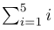
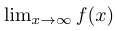
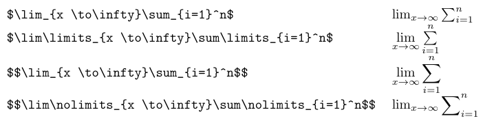
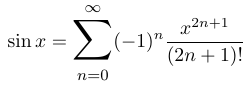

# Most popular LaTeX math symbols

## The LaTeX Summation Symbol

One of the key symbols frequently used in mathematical equations is the summation symbol. In the following section, we will explore the usage and formatting of the summation symbol in LaTeX.

The summation symbol, denoted by the Greek letter **Sigma**, is used to represent the addition of a series of terms. It allows mathematicians to concisely express concepts such as sums, sequences, and series. In LaTeX, the summation symbol can be easily incorporated into mathematical expressions using specific commands.

## Using the LaTeX Sum Symbol

To use the summation symbol in LaTeX, the command `\sum` is used. The general syntax is as follows:

```tex
\sum_{i=lower}^{upper} expression
```

Here, the variable *i* represents the index of summation. The lower and upper limits define the range over which the summation is performed. The expression, which can contain mathematical terms, is what gets summed.

For example, to represent the sum of numbers from 1 to 5, the LaTeX code would be:

```tex
$\sum_{i=1}^{5} i$
```

which will result in the following output:



## The LaTeX Limit Symbol

Another frequently used LaTeX math symbol is the LaTeX limit symbol. Below, we will delve into its significance and usage in mathematical equations.

The LaTeX limit symbol, often denoted as **lim**, is a fundamental mathematical symbol used to describe the behavior of a function as it approaches a specific value or infinity. By understanding the LaTeX commands associated with this symbol, users can accurately represent limits in their mathematical expressions.

## Using the LaTeX Limit Symbol

To generate the limit symbol in LaTeX, simply use the command `\lim` followed by any additional specifications required. For example, typing 
```tex
$\lim_{x \to \infty}f(x)$
```
will produce the limit symbol with the variable `x` approaching infinity as follows:



This notation effectively communicates that the function's behavior is being observed as the input variable approaches an infinitely large value.

In mathematical equations, the LaTeX limit symbol plays a crucial role in expressing the behavior and boundaries of functions. It allows researchers, educators, and students to accurately describe and analyze mathematical concepts such as convergence, continuity, and differentiability.

Furthermore, the LaTeX limit symbol can be combined with other symbols and operators to create more complex mathematical expressions. For example, using the limit symbol in conjunction with the summation symbol allows users to express summations with variable limits. This flexibility and versatility make LaTeX an invaluable tool for mathematical typesetting.

## LaTeX Limits in Mathematical Typesetting

Symbol limits in LaTeX allow users to define the boundaries or constraints of mathematical expressions. They are essential for accurately representing concepts such as summation, integration, and product operations. By using the appropriate LaTeX commands, users can position limits on symbols to specify the range or behavior of the mathematical operations.

To illustrate symbol limits in LaTeX, let's consider the summation symbol as an example. The summation symbol is commonly used to express the sum of a series of terms. By using the command `\sum`, users can generate the summation symbol. However, to define the limits of the summation, additional commands are required.

For example, typing

```tex
$\sum_{i=1}^n$
```

will position the lower index as `i=1` and the upper index as `n`. This notation indicates that the summation operation should be performed for values of *i* starting from *1* and ending at *n*.

In addition to the default positioning, LaTeX also allows users to customize the placement of limits. By using the command `\limits`, users can position limits above and below the summation symbol. For instance, typing

```tex
$\sum\limits_{i=1}^n$
```

will position the limits above and below the summation symbol, providing a clearer representation. This is also the default behavior in display mode. Thus

```tex
$$\sum{i=1}^n$$
```

doesn't require `\limits`. But to switch back to the limits in index positions, `\nolimits` is required.

Compare the variants in the table below:



## LaTeX Big Sum Symbol

In this section, we will explore how to obtain a larger summation symbol in LaTeX using the `relsize` package. With the `relsize` package, users can easily adjust the size of mathematical symbols, including the summation symbol, to suit their specific needs.

To begin, users need to include the `relsize` package in their LaTeX document by adding the following line to the preamble:

```tex
\usepackage{relsize}
```

Once the package is included, users can utilize the `\mathlarger{}` command to obtain a larger version of the summation symbol. By inserting the desired expression within the curly braces of `\mathlarger{}`, the summation symbol will be displayed in a larger size.

Consider the following example:

```tex
\begin{equation*}
\sin x = \mathlarger{\mathlarger{\sum}}_{n=0}^{\infty}(-1)^n\frac{x^{2n + 1}}{(2n + 1)!}
\end{equation*}
```

which results in the output below:



As we can see, the `relsize` package in LaTeX provides a convenient way to obtain a larger summation symbol. By including the package in the document's preamble and utilizing the `\mathlarger{}` command, users can adjust the size of the summation symbol to suit their specific needs.