The *amsmath* package contains a number of environments definitions for typing displayed math formulas. They can be classified by the number of material lines (single or multiple) and by the number of alignment points.

> In this section, we will use the term *equation* in the following way: to refer to a *logical* distinct part of a math display, which is often numbered for reference and is also labeled (for example, by its number in parentheses). Such labels are also called *tags*.

The following list contains the most popular display environments. Where appropriate they have starred forms in which there's no tagging of the equations.

||
|---|---|---|
| `equation` | `equation*` | One line, one equation |
| `multline` | `multline*` | One unaligned multiple-line equation, one equation number |
| `gather` | `gather*` | Several equations without alignment |
| `align` | `align*` | Several equations with multiple alignments |
| `flalign` | `flalign*` | Several equations: horizontally spread form of `align` |
| `split` | | A simple alignment within a multiple-line equation |

All examples in this chapter are typeset with the math material centered and the equation numbers (tags) on the right. To visualize the positioning, we present blue vertical lines in the output that represent the left and right margins, as well as the center line. In LaTeX source code, we use the `% -----...` comment to separate lines that should be placed in the document preamble from those that should be placed in the body.

```tex
\usepackage[leqno]{amsmath}
% -------------------------------------------------------------------------------
\begin{equation} (a-b)^2 = a^2-2ab+b^2 \end{equation}
\[ \cos2\eta = \cos^2\eta-\sin^2\eta \]
```

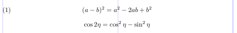

If you want to position the mathematics at a fixed indent from the left margin, rather than centered in the text column, the `fleqn` option is available. You can specify the size of the indent in the preamble by setting the value of the rubber length `\mathindent`. Its default value is the same as the indentation of a first-level list. If you're content with this value, you may skip setting the `\mathindent` length.

```tex
\usepackage[fleqn,reqno]{amsmath}
\setlength\mathindent{0.2in}
% -------------------------------------------------------------------------------
\begin{equation} (a-b)^2 = a^2-2ab+b^2 \end{equation}
\[ \cos2\eta = \cos^2\eta-\sin^2\eta \]
```

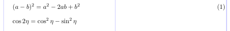

There's no need to pass the `reqno` option here (as it is the default), but it overrides the document class settings, so the equation number is forced to the right whatever happens.

In standard LaTeX, `&` and `\\` are used for column and line separation within displayed alignments. The details of their usage change in the `amsmath` environments.

## 2.1. Comparison with standard LaTeX

Some of the multi-line display environments allow you to align parts of the formula. Compared to the standard LaTeX environments `eqnarray` and `eqnarray*`, the structures defined in the `amsmath` package provide a slightly different and simpler way of marking the alignment points. In standard LaTeX, `eqnarray*` is similar to an `array` environment with `{rcl}` as the preamble, which means that two `&` chars are required to indicate the two alignment points. In the `amsmath` package, equivalent structures have only a single alignment point (as if `array` had a `{rl}` preamble), so you need to put only one `&` char to the left of the symbol (usually a relation) that should be aligned.

The `eqnarray` environment produces extra space at the alignment points depending on the parameter settings for `array`. The `amsmath` structures, at the same time, give fixed spacing. The difference is clearly illustrated by the next example. The same equation is typeset using the `equation`, `align` and `eqnarray` environments.

```tex
\usepackage{amsmath}
% -------------------------------------------------------------------------------
\begin{equation}
x^2 + y^2 = z^2
\end{equation}
\begin{align}
x^2 + y^2 &= z^2 \\
x^3 + y^3 &< z^3
\end{align}
\begin{eqnarray}
x^2 + y^2 &=& z^2 \\
x^3 + y^3 &<& z^3
\end{eqnarray}
```

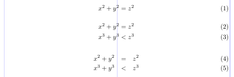

Note that the spaces in the `eqnarray` environment come out too wide for conventional standards of mathematical typesetting.

As in standard LATEX, lines in an `amsmath` display are marked with `\\` (or the end of the environment). Because line breaking in a mathematical display usually requires a deep understanding of the structure of the formula, it is commonly considered to be beyond today's software capabilities.

## 2.2. A single equation on one line

A single equation can be produced by the `equation` environment. A tag is automatically generated and placed on the extreme left or right according to the option in use. The `equation*` environment produces the same equation without a tag. Standard LaTeX also has `equation`, but not `equation*`, as the latter is similar to the standard displayed math environment.

A notable fact is that the presence of the tag doesn't affect the positioning of the contents. The tag will be shifted up or down in case there's not enough room for it on the one line: to the previous line when equation tags are on the left, and to the next line when tags are on the right.

```tex
\usepackage[leqno]{amsmath}
% -------------------------------------------------------------------------------
\begin{equation*}
n^2 + m^2 = k^2
\end{equation*}
\begin{equation}
n^p + m^p \neq k^p \qquad p > 2
\end{equation}
```

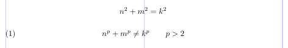

## 2.3. A single equation on several lines without alignment

A variation of the `equation` environment is the `multline` environment. It is used only for equations that don't fit on a single line. The `\\` char must be used to mark the line breaks, as they are not found automatically.

The first line of the `multline` will be aligned on an indentation from the left margin and the last one on the same indentation from the right margin. The value of the `\multlinegap` length defines the size of this indentation.

Each line other than the first and last is centered individually within the display width (unless `fleqn` option is used). However, if you add either `\shoveleft` or `\shoveright` command within a line, that line will be forced to the left or to the right.

A `multline` environment has a single tag, as it logically is a single equation. Therefore, none of the individual lines can be changed by the use of `\tag` or `\notag`. The tag, if present, is placed flush right/left on the last/first line when `reqno`/`leqno` option is used.

```tex
\usepackage{amsmath}
% -------------------------------------------------------------------------------
\begin{multline}
\text{First line of a multline} \\
\text{Centered Middle line} \\
\shoveright{\text{A right Middle}} \\
\text{Another centered Middle} \\
\text{Yet another centered Middle} \\
\shoveleft{\text{A left Middle}} \\
\text{Last line of the multline}
\end{multline}
```

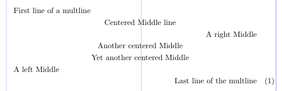

The next example shows how `\multlinegap` affects the result. In the first case, the "*dy*"s line up, which looks like a tag is missing from the first line of the equation. When `\multlinegap` is set to `0`, the space on the left of the second line doesn't change because of the tag, while the first line is shifted to the left margin, making it clear that this is a single equation.

```tex
\usepackage{amsmath}
% -------------------------------------------------------------------------------
\begin{multline} \tag{2}
\sum_{t \in \mathbf{T}} \int_a^t \biggl\lbrace \int_a^t f(t - x)^2 \, g(y)^2 \,dx \biggr\rbrace \,dy \\
= \sum_{t \notin \mathbf{T}} \int_t^a \biggl\lbrace g(y)^2 \int_t^a f(x)^2 \,dx \biggr\rbrace \,dy
\end{multline}
\setlength\multlinegap{0pt}
\begin{multline} \tag{2}
\sum_{t \in \mathbf{T}} \int_a^t \biggl\lbrace \int_a^t f(t - x)^2 \, g(y)^2 \,dx \biggr\rbrace \,dy \\
= \sum_{t \notin \mathbf{T}} \int_t^a \biggl\lbrace g(y)^2 \int_t^a f(x)^2 \,dx \biggr\rbrace \,dy
\end{multline}
```

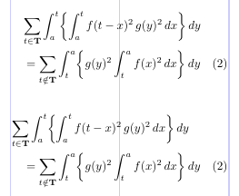

## 2.4. A single equation on several lines with alignment

When you need to align a single multiline equation, the `split` environment is at your service. Just use a single `&` char on each line to mark the alignment points.

```tex
\usepackage{amsmath}
% -------------------------------------------------------------------------------
\begin{equation}
\begin{split}
(a + b)^4 &= (a + b)^2 (a + b)^2 \\
          &= (a^2 + 2ab + b^2)(a^2 + 2ab + b^2) \\
          &= a^4 + 4a^3b + 6a^2b^2 + 4ab^3 + b^4
\end{split}
\end{equation}
```

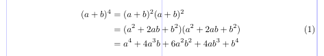

A `split` doesn't itself create an equation tag (so the starred variant is not needed), because it's always used as the content of a single equation. For this purpose, you may put it into an outer environment.

By default, the tag (as well as any part of the equation outside the `split`) is centered vertically on the total height of the `split` environment material. This behavior corresponds to the `centertags` option. When you specify the `tbtags` option, the tag is placed on the last line of the `split` when the tag is on the right, and on the first line when the tag is on the left.

```tex
\usepackage[tbtags]{amsmath}
% -------------------------------------------------------------------------------
\begin{equation}
\begin{split}
(a - b)^3 &= (a - b) (a - b)^2 \\
          &= (a - b)(a^2 - 2ab + b^2) \\
          &= a^3 - 3a^2b + 3ab^2 - b^3
\end{split}
\end{equation}
```

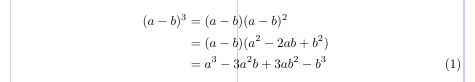

## 2.5. Equation groups without alignment

When you need to put two or more equations into a single display without alignment between the equations, you can use the `gather` environment. It also separately centers each equation within the display width and equips with an individual tag, if needed. Each line of a `gather` is logically a single equation.

```tex
\usepackage{amsmath}
% -------------------------------------------------------------------------------
\begin{gather}
(a + b)^2 = a^2 + 2ab + b^2 \\
(a + b) \cdot (a - b) = a^2 - b^2
\end{gather}
```

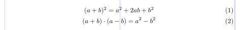

You may need to suppress the equation number for a certain line. The `\notag` command, put in the logical line, is the answer. The `gather*` environment doesn't tag equations at all.

```tex
\usepackage{amsmath}
% -------------------------------------------------------------------------------
\begin{gather}
D(a,r) \equiv \{ z \in \mathbf{C} \colon |z - a| < r \} \notag \\
\operatorname{seg} (a, r) \equiv \{ z \in \mathbf{C} \colon \Im z < \Im a, \ |z - a| < r \} \\
C (E, \theta, r) \equiv \bigcup_{e \in E} c (e, \theta, r)
\end{gather}
```

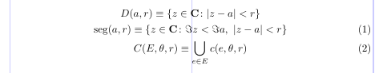

## 2.6. Equation groups with simple alignment

When you need to typeset more than one equation in a single display and align them vertically, the `align` environment comes to the rescue. In the simplest case, you use a single `&` on each line to mark the alignment point.

```tex
\usepackage{amsmath}
% -------------------------------------------------------------------------------
\begin{align}
(a - b)^3 &= (a - b) (a - b)^2 \\
          &= (a - b)(a^2 - 2ab + b^2) \\
          &= a^3 - 3a^2b + 3ab^2 - b^3
\end{align}
\begin{align}
x^2 + y^2 &= 1 \\
        y &= \sqrt{1-x^2}
\end{align}
```

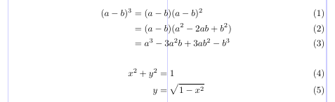

## 2.7. Multiple alignments

An `align` environment can define multiple alignment points. The layout contains as many column-pairs as necessary and is similar to an `array` with the `{rlrl...}`-like preamble. Assuming it consists of *n* such `rl` column-pairs, the number of `&`'s per line will be *2n - 1*: one for alignment within each column-pair giving *n*; and *n - 1* `&`'s to separate the column-pairs.

The `align` environment spreads the material evenly across the display width. If there's extra space, it is distributed equally between adjacent column-pairs and the two display margins.

```tex
\usepackage{amsmath}
% -------------------------------------------------------------------------------
This example has two column-pairs.
\begin{align} \text{Compare }
x^2 + y^2 &= 1 &                      x^3 + y^3 &= 1 \\
x              &= \sqrt {1-y^2}   &           x &= \sqrt[3]{1-y^3}
\end{align}
This example has three column-pairs.
\begin{align}
     x &= y        &        X &= Y      &   a &= b+c \\
    x' &= y'       &       X' &= Y'     &  a' &= b \\
x + x' &= y + y'   &   X + X' &= Y + Y' & a'b &= c'b
\end{align}
```

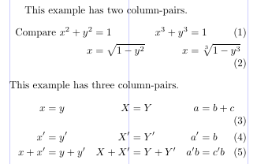

The `flalign`'s layout is similar, but there's no space at the margins. In the next example, you can see that equation (3) fits on a single line due to this fact (while equation (2) still doesn't).

```tex
\usepackage{amsmath}
% -------------------------------------------------------------------------------
This example has two column-pairs.
\begin{flalign} \text{Compare }
x^2 + y^2 &= 1               &   x^3 + y^3 &= 1 \\
        x &= \sqrt {1-y^2}   &           x &= \sqrt[3]{1-y^3}
\end{flalign}
This example has three column-pairs.
\begin{flalign}
     x &= y        &        X  &= Y        &     a &= b+c \\
    x' &= y'       &       X'  &= Y'       &    a' &= b \\
x + x' &= y + y'   &   X + X'  &= Y + Y'   &   a'b &= c'b
\end{flalign}
```

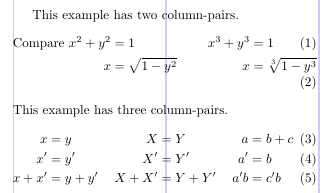

In both cases the minimum space between column-pairs can be set by changing `\minalignsep`. The default value is `10pt` and can be changed with `\renewcommand`, as it is a macro command rather than a length parameter. The next example demonstrates the effect of changing `\minalignsep`.

```tex
\usepackage{amsmath}
% -------------------------------------------------------------------------------
This example has two column-pairs.
\renewcommand\minalignsep{0pt}
\begin{align} \text{Compare }
x^2 + y^2 &= 1               &   x^3 + y^3 &= 1 \\
        x &= \sqrt {1-y^2}   &           x &= \sqrt[3]{1-y^3}
\end{align}
This example has three column-pairs.
\renewcommand\minalignsep{15pt}
\begin{flalign}
     x &= y        &        X  &= Y        &     a &= b+c \\
    x' &= y'       &       X'  &= Y'       &    a' &= b \\
x + x' &= y + y'   &   X + X'  &= Y + Y'   &   a'b &= c'b
\end{flalign}
```

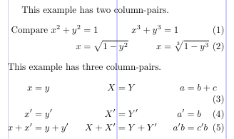

The next example illustrates a very common use for `align`. Note the use of `\text` to produce normal text within the mathematical material.

```tex
\usepackage{amsmath}
% -------------------------------------------------------------------------------
\begin{align}
     x &= y        &&   \text{by hypothesis} \\
    x' &= y'       &&   \text{by definition} \\
x + x' &= y + y'   &&   \text{by Axiom 1}
\end{align}
```

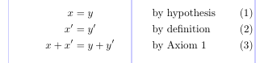

## 2.8. Interrupting displays: `\intertext`

You may want to put a small piece of text between the lines of a display alignment. This is done with the `\intertext` command. It's very important that all the alignment properties stay unaffected by the text, while the text itself is typeset as a normal paragraph set to the display width. The alignment won't work if you just end the display and then start a new one after the text. This command must always immediately follow a `\\` or `\\*` command.

``` tex
\usepackage{amsmath}
% -------------------------------------------------------------------------------
\begin{align}
A_1 &= N_O (\lambda ; \Omega') - \phi ( \lambda ; \Omega') \\
A_2 &= \phi (\lambda ; \Omega') \phi (\lambda ; \Omega) \\
\intertext{and finally}
A_3 &= \mathcal{N} (\lambda ; \omega)
\end{align}
```

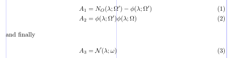

> The words "and finally" are outside the alignment, at the left margin, but all three equations are aligned.

## 2.9. Equation numbering and tags

In LaTeX, the tags for equations are typically generated automatically, and they are essentially a printed representation of the LaTeX counter `equation`. This is done by LaTeX in three steps: setting the value of the `equation` counter; formatting the tag; and printing it in the right position.

The first two steps are closely linked, because the `equation` counter value is increased only when the corresponding tag is automatically printed. Let's take a look at a display environment that has both starred and unstarred forms. Only the unstarred form changes the value of the `equation` counter, since it automatically tags each logical equation while the starred form doesn't.

When you need to suppress the setting of a tag for a certain logical equation within the unstarred form, you put `\notag` (or `\nonumber`) *before* the `\\`. You can also replace the default tags with ones of your own design by using the `\tag` command *before* the `\\`. The argument of this command can be arbitrary normal text that is typeset, in parentheses, as the tag for that equation.

Note that the incrementing of the counter value is also suppressed when `\tag` is used. This means that the default tag setting is only visually the same as `\tag{\theequation}`; they aren't equivalent. The starred form, `\tag*`, typesets the text in its argument without the parentheses (and without any other stuff that might otherwise be added with a particular document class).

```tex
\usepackage{amsmath}
% -------------------------------------------------------------------------------
\begin{align}
x^2+y^2 &= z^2 \label{eq:A} \\
x^3+y^3 &= z^3 \notag \\
x^4+y^4 &= r^4 \tag{$*$} \\
x^5+y^5 &= r^5 \tag*{$*$} \\
x^6+y^6 &= r^6 \tag{\ref{eq:A}$'$} \\
A_1 &= N_0 (\lambda ; \Omega') - \phi ( \lambda ; \Omega') \\
A_2 &= \phi (\lambda ; \Omega') \, \phi (\lambda ; \Omega) \tag*{ALSO (\theequation)} \\
A_3 &= \mathcal{N} (\lambda ; \omega)
\end{align}
```

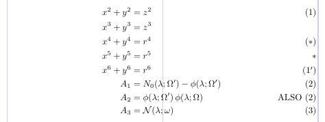

> Notice how the `\label` and `\ref` commands are used to provide some sort of "relative numbering" for equations.

## 2.10. Subordinate numbering sequences

The *amsmath* package also supports the so-called "equation sub-numbering". The `subequations` environment produces tags of the form (2a), (2b), (2c), and so on. This numbering scheme is based on two normal LaTeX counters: `parentequation` and `equation`. All the tagged equations within a `subequations` environment use this scheme.

The following example shows that the tag can be redefined to some extent, but note that the redefinition for `\theequation` must be placed into the `subequations` environment.

```tex
\usepackage{amsmath}
% -------------------------------------------------------------------------------
\begin{subequations} \label{eq:1}
\begin{align}
           f &= g \label{eq:1A} \\
          f' &= g' \label{eq:1B} \\
\mathcal{L}f &= \mathcal{L}g \label{eq:1C}
\end{align}
\end{subequations}

\begin{subequations} \label{eq:2}
\renewcommand\theequation{\theparentequation\roman{equation}}
\begin{align}
           f &= g \label{eq:2A} \\
          f' &= g' \label{eq:2B} \\
\mathcal{L}f &= \mathcal{L}g + K \label{eq:2C}
\end{align}
\end{subequations}
Note the relationship between~\eqref{eq:1}
and~\eqref{eq:2}: only~\ref{eq:1C} and~\ref{eq:2C} differ.
```

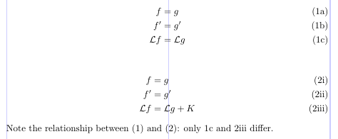

> The `subequations` environment must appear *outside* the displays that it affects. It also shouldn't be nested within itself. The "main" equation counter is incremented with each use of this environment. A `\label` command within the `subequations` environment but outside any individual (logical) equation will produce a `\ref` to the parent number (e.g., to 2 rather than 2i).

## 2.11. Resetting the equation counter

It is common practice to have equations numbered within sections or chapters with tags of the form (1.1), (1.2), ..., (2.1), (2.2), ... . The `amsmath` package provides an easy way to set this up with the `\numberwithin` declaration.

For example, to get equation tags including the section number, with the equation counter being automatically reset for each section, put this declaration in the preamble: `\numberwithin{equation}{section}`.

## Appendix A. Rendering LaTeX equations with Aspose.TeX API

Now we will look at the way the Aspose.TeX API allows you to get LaTeX equations as standalone figures.

Let's say that you need to get an equation as a raster image so that you can use it in some non-TeX publication (a web page, for example). Using the Aspose.TeX API, you can do it as follows:

```csharp
string equation = @"\begin{equation} (a-b)^2 = a^2-2ab+b^2 \end{equation}
\[ \cos2\eta = \cos^2\eta-\sin^2\eta \]";
Aspose.TeX.Features.PngMathRendererOptions options = new Aspose.TeX.Features.PngMathRendererOptions();
using (Stream stream = File.Open("your-file-name-and-path", FileMode.Create))
{
    new Aspose.TeX.Features.PngMathRenderer().Render(equation, stream, options, out System.Drawing.SizeF size);
    // Below is the short version for rendering with SVG
    // new Aspose.TeX.Features.SvgMathRenderer().Render(equation, stream, new Aspose.TeX.Features.SvgMathRendererOptions(), out System.Drawing.SizeF size);
}
```

As you can see, the API is also capable of converting a LaTeX equation to an SVG file. And that was an example of using Aspose.TeX for .NET. Below is the equivalent code for Java version.

```java
String equation = "\\begin{equation} (a-b)^2 = a^2-2ab+b^2 \\end{equation}\r\n" +
		"\\[ \\cos2\\eta = \\cos^2\\eta-\\sin^2\\eta \\]";
Size2D size = new Size2D.Float();
com.aspose.tex.PngMathRendererOptions options = new com.aspose.tex.PngMathRendererOptions();
final OutputStream stream = new FileOutputStream(Helper.getOutputFile(Path.combine(getCurrentPath(), "doc.png")));
try
{
    new com.aspose.tex.PngMathRenderer().render(equation, stream, options, size);
}
finally {
    stream.close();
}
```

You can find details about using renderer options in the article on rendering LaTeX math formulas with [Aspose.TeX for .NET](/tex/net/latex-math-formula-rendering/) or [Aspose.TeX for Java](/tex/java/latex-math-formula-rendering/). But one of them is important for us here. Using this option, you can specify the LaTeX document preamble that you would need to get the result you want. (Hereafter, we will present only the C# version of the source code.)

```csharp
// The preamble for the very first example on this page
options.Preamble = @"\usepackage[leqno]{amsmath}";
```

You may also use this option when you need to get an equation laid out in an area narrower than LaTeX `\textwidth` defines by default. You have two options to achieve this goal:

```csharp
// The preamble for the 2.7 examples
options.Preamble = @"\usepackage[textwidth=232pt]{geometry}
\usepackage{amsmath}";
// or
options.Preamble = @"\usepackage{amsmath}
\setlength{\textwidth}{232pt}";
```

In the Aspose.TeX API, the following preamble is used by default, so unless you need to pass options to the `amsmath` package or change the default `\textwidth` or something else, there's no need to specify the preamble in renderer's options:

```tex
\usepackage{amsmath}
\usepackage{amsfonts}
\usepackage{amssymb}
```

## Appendix B. Rendering LaTeX equations with Aspose LaTeX Equation web app

There is also the [LaTeX Equation Editor web app](https://products.aspose.app/tex/equation-editor) that allows you to edit and view LaTeX equations. You can enter your equation in the text field and click the *View* button to see the result. Or, you can use the control panel above the field to build the equation by selecting a subexpression category, then subexpression, and then editing the argument, if any. You can find the preamble and other options below the *Formula* field.