## 6.1. The `\text` command

To put normal text inside mathematics, it's better to use `\text` command rather than commands like `\mathrm`. The `\text` command ensures that the text is set using the correct font size. The font will be the text font in use outside the current math material.

```tex
\usepackage{amsmath}
% -------------------------------------------------------------------------------
\begin{gather}
\text{Also, if } \Delta_{\text{max up}} = \Delta_{\text{min down}} \notag \\
\text{(for all ups and downs) then} \notag \\
\Delta_{\text{sum of ups}} = \Delta_{\text{sum of downs}}
\end{gather}
```

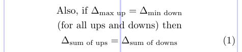

## 6.2. Operator names

The names of common math functions (e.g., *sin* and *log*) and operators (e.g., *min* and *sup*) are typically preferred to be distinguished from variable names that are set in italics. So, they are traditionally set as text in Roman type. There are predefined commands in standard LaTeX for the most common functions and operators. The `amsmath` package sufficiently extends the set of such commands. The following table lists both the "standard" commands and the commands provided by `amsmath`. The latter are highlighted in bold. Those set in italics may have a subscript/superscript in the limit position when used in displayed formulas.

|||||||
|:---:|---|:---:|---|:---:|---|
|  | `\arccos` | 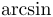 | `\arcsin` | 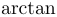 | `\arctan` |
| 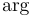 | `\arg` |  | `\cos` | 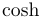 | `\cosh` |
|  | `\cot` | 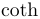 | `\coth` |  | `\csc` |
| 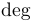 | `\deg` | 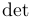 | *`\det`* | 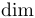 | `\dim` |
| 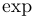 | `\exp` | 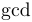 | *`\gcd`* | 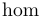 | `\hom` |
| 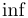 | *`\inf`* | 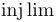 | ***`\injlim`*** | 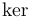 | `\ker` |
| 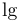 | `\lg` | 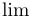 | *`\lim`* | 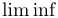 | *`\liminf`* |
| 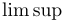 | *`\limsup`* | 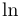 | `\ln` | 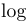 | `\log` |
|  | *`\max`* | 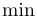 | *`\min`* |  | *`\Pr`* |
| 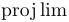 | ***`\projlim`*** |  | `\sec` | 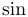 | `\sin` |
| 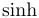 | `\sinh` | 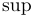 | *`\sup`* | 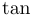 | `\tan` |
| 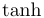 | `\tanh` | 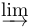 | ***`\varinjlim`*** | 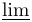 | ***`\varliminf`*** |
| 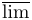 | ***`\varlimsup`*** | 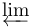 | ***`\varprojlim`*** |  |  |

```tex
\usepackage[fleqn]{amsmath}
\newcommand\abs[1]{\lvert#1\rvert}
\setlength\mathindent{0pt}
% -------------------------------------------------------------------------------
\begin{gather*}
\lim_{x \rightarrow 0} \frac{ \sin^2(x) }{ x^2 } = 1 \\
\varliminf_{n \rightarrow \infty}
\abs{a_{n+1}} / \abs{a_n} = 0 \\
\varinjlim (m_i^\lambda \cdot M)^* \le
\varprojlim_{A/p \rightarrow \lambda(A)}A_p \le 0
\end{gather*}
```

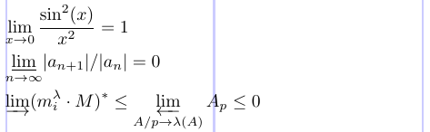

It often turns out that this list is not enough. The `amsmath` package defines a general method to define new "operator names".

```tex
\DeclareMathOperator*{cmd}{text}
```

The `\DeclareMathOperator` command defines `cmd` to produce `text` in the appropriate font for "textual operators". If the new operator is expected to have subscripts/superscripts in the limit position (when used in displays), then the starred form `\DeclareMathOperator*` should be used. In addition to using the proper font, `\DeclareMathOperator` sets up good spacing on either side of the operator name. The text argument is processed using a "pseudo-text mode" in which

 - The hyphen char is printed as a text hyphen (not a minus sign) (see `\supminus` in the next example).
 - The asterisk char `*` is printed as a raised text asterisk (not centered).
 - Otherwise, the text is processed in math mode so that spaces are ignored and you can use subscripts, superscripts and other elements.

The following example shows how to provide the command `\meas` for the new function name "meas" (measure) and the operator functions `\esssup` and `\supminus` (both may have subscripts/superscripts in the limit position).

```tex
\usepackage[fleqn]{amsmath}
\DeclareMathOperator \meas {meas}
\DeclareMathOperator*\esssup {ess \, sup}
\DeclareMathOperator*\supminus{sup - minus*}
\newcommand\abs [1]{\lvert#1\rvert}
\newcommand\norm[1]{\lVert#1\rVert}
% -------------------------------------------------------------------------------
\begin{gather*}
  \norm{f}_\infty = \esssup_{x \in R^n} \abs{f(x)} \\
  \meas_1 \{ u \in R_+^1 \colon f^*(u)>\alpha \} \\
  \quad \esssup_{x \in R^i} \; \meas_i
  \{ u \in R^n \colon \abs{f(u)} \geq \alpha \} \\
  \quad (\forall \alpha \in \supminus_{f^*} R_{*+})
\end{gather*}
```

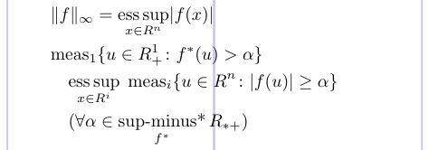

Such declarations must appear in the preamble, and it's impossible to change them temporarily. Strictly speaking, `\DeclareMathOperator` can be used only for command names that haven't previously been used. To replace an existing command, you must first remove the previous definition before redeclaring it.

```tex
\usepackage{amsmath}
%% Low-level TeX needed here to cancel the old the definition of \csc:
\let \csc \relax
\DeclareMathOperator\csc{cosec}
\newcommand\calQ{\mathcal{Q}}
% -------------------------------------------------------------------------------
\[
\varlimsup_{n\to\infty} \calQ (u_n, u_n - u^{\#})
  \ge \csc (\calQ' (u^{\#}))
\]
```

