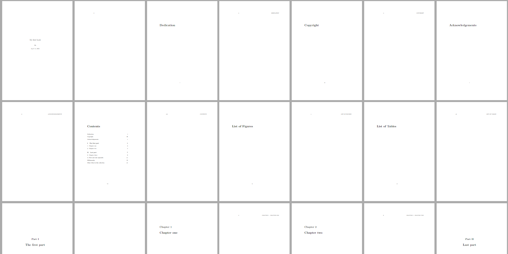
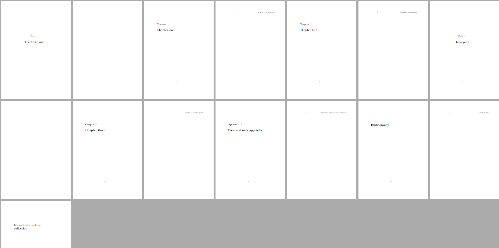
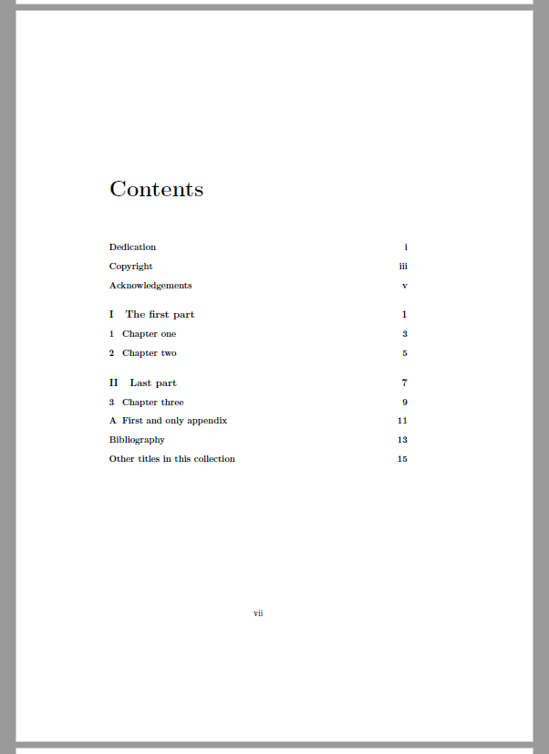
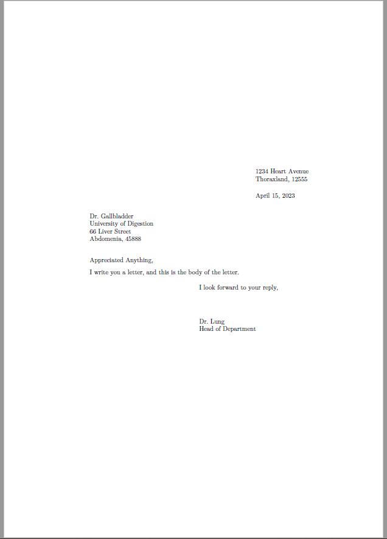

## What is a documentclass in LaTeX?

LaTeX defines some rules which every document author must follow. It also defines the structure of the source file, which is essentially a typesetting program. According to this structure, the document source code must contain a part responsible for the document content itself - *body* - which is enclosed in a pair of commands: `\begin{document}` and `\end{document}`. LaTeX ignores anything that follows the end of the body. The part of the source code prior to `\begin{document}` is called the *preamble*.

Typically, the first command in the preamble has to be `\documentclass`, which takes a single required argument that is the name of the **document class**. The document class itself is a set of formatting parameters, layout metrics, macros, etc. that are suitable and useful for developing documents of a certain type and collected under the single name. In this article, we will discuss the LaTeX **predefined** document classes that are built-in LaTeX and show their uses, differences, and similarities. We will also mention some optional arguments that the `\documentclass` command can take, and that customize the appearance of the document.

## Predefined LaTeX document classes

The standard LaTeX contains the following document classes:

| <div style="text-align:center;">LaTeX<br>document<br>class</div> | <div style="text-align:center;">Usage</div> |
|---|---|
| **article** | LaTeX article class is used to create articles for scientific journals, short reports, program documentation, and in general any short document that doesn't need a complex division into chapters and parts. |
| **report** | LaTeX report class is used for long articles that can contain several chapters (something like small books and thesis). |
| **book** | This is used to typeset real books. It includes all kinds of typesetting standards suitable for printed books: chapters and parts, two kinds of pages, front matter, back matter, etc.|
| **slides** | It may be used to produce slides, although there is the external package [beamer](https://ctan.org/pkg/beamer) that is much more powerful for this purpose. |
| **letter** | This document class is used for writing letters. |

The first two document classes are basic. So, start with **article** whenever you are not sure which class you need.

The **report** class is very similar. The main difference from **article** is that you can insert chapters with the `\chapter` command, while the **article** document class doesn't define such a sectioning unit.

## The LaTeX **book** class

Books, in typographical standards, have the front matter and back matter, which are the main difference between books and, say, reports or articles. The front matter of a book usually consists of a half-title page, a main title page, a copyright page, a preface or foreword, and a table contents. Less obligatory parts are acknowledgements, a dedication, a list of figures, a list of tables, a list of other books in the same series, and other editorial and promotional content. The back matter typically includes an index, and may contain an afterword, as well as acknowledgements, a bibliography, a colophon, etc.

The book document class offers you commands to produce the aforementioned logical structures, while other document classes can't provide you with such tools. However, different publishers usually have their own packages with additional commands for laying out structures according to their own style.

## Front matter, main matter and back matter commands

The main matter is what includes the body of the book, starting with the first chapter or part and ending with appendices. The front, main, and back matters begin with the `\frontmatter`, `\mainmatter` and `\backmatter` commands, respectively.

> In the standard book class, front matter pages are numbered with Roman numerals, while main and back matter pages are numbered with Arabic numerals.

> The `\chapter` command doesn't produce a chapter number in the front and back matters, although it does create an entry in the table of contents. This is typically used to create a preface or acknowledgements section. Within such chapters, only the starred versions of other sectioning commands (like, `\section*` and `\subsection`) should be used.

## An example of using the LaTeX book class

```tex
% Book document class
\documentclass{book}

\title{My first book}
\author{Me}
\date{\today}

\begin{document}

\maketitle

\frontmatter
\chapter{Dedication}
\chapter{Copyright}
\chapter{Acknowledgements}

\tableofcontents

\listoffigures
\listoftables

\mainmatter
\part{The first part}
\chapter{Chapter one}
\chapter{Chapter two}

\part{Last part}
\chapter{Chapter three}

\appendix
\chapter{First and only appendix}

\backmatter
\chapter{Bibliography}
\chapter{Other titles in this collection}

\end{document}
```

Below is the document structure generated by this LaTeX code:

<a href="/tex/java/latex-document-classes/latex-document-classes-1.png" style="display:inline-block;width:49%;"></a>
<a href="/tex/java/latex-document-classes/latex-document-classes-2.png" style="display:inline-block;width:49%;"></a>

And here is the table of contents in detail:

<a href="/tex/java/latex-document-classes/latex-document-classes-3.png"></a>

## **Odd** and **even** pages in books

In books, **odd** and **even** pages don't look the same. Margins, and usually headers and footers, differ to make the book more readable when it is bound. The LaTeX document class handles this, and you may find that:

- **left (even)** pages have a larger left margin, the page number is at the top right of the page, and the title of the current chapter is on the right;
- **right (odd)** pages have a larger right margin and only the page number at the top right of the page.

Note that new chapters always start on the right page, where the page head is empty, leaving only the page number at the center of the foot.

## **Abstract** section is missing

Academic papers, such as articles or reports, usually include an introductory section called **"Abstract"**. Its purpose is to give a quick overview of the topic covered in the document. You may find it printed just after the title and before the table of contents, with the heading "Abstract" set in bold. In LaTeX, such a structure is implemented as the `abstract` environment.

The **abstract** environment isn't provided by the book document class, and this is another difference from the article and report classes.

## LaTeX **letter** class

At present time, the letter document class seems to be somewhat old-fashioned (so is the slide document class, actually). If you need to make traditional letters, to put them in envelopes and send them by mail, this document class will probably be useful to you. Although this is a kind of obsolete way of communication, there are still cases when you might need to prepare a letter-like document. For example, a letter of recommendation or a letter of presentation.

So, here is the brief overview of the class.

You can generate any number of letters having a single input file. Your name and address, which are typically the same for all letters, are usually specified in the document preamble. The return address is declared by an `\address` command, which accepts multiple lines separated by `\\` (the LaTeX line break command) as the argument. Similarly, the `\signature` command accepts multiple lines including your name, title, etc. However, you can change the return address and signature at any point.

Each letter is generated by a separate `letter` environment that requires the recipient's name and address as its argument. The letter begins with an `\opening` command, producing the salutation, and ends with a `\closing` command, producing the closing phrase and signature. The body of the letter is normal LaTeX input.

All of these commands are easy to use and very powerful as LaTeX automatically takes care of formatting the letters. So don't let the number of commands scare or confuse you.

The example below demonstrates how this all works.

```tex
% Example of a letter document class
\documentclass{letter}
 
\address{1234 Heart Avenue\\ Thoraxland, 12555}

\signature{Dr.~Lung\\ Head of Department}

\begin{document}

\begin{letter}
{Dr.~Gallbladder \\ University of Digestion\\ 66 Liver Street\\ Abdomenia, 45888}

\opening{Appreciated Anything,}

I write you a letter, and this is the body of the
letter.

\closing{I look forward to your reply,}

\end{letter}

\end{document}
```

<a href="/tex/java/latex-document-classes/latex-document-classes-4.png"></a>

Note that the current date is also produced automatically. However, you can redefine the `\today` command to change the date in your letters. Here's how you do it:

```tex
\renewcommand{\today}{01th of March of 2492}
```

If you insert this declaration in a certain `letter` environment, it will change the date only for that letter. Otherwise, if you insert it in the preamble it will be in force for all letters generated by the input file (unless it's inserted in a certain `letter` environment).

## LaTeX document class options

Let's now take a look at the `\documentclass` command options mentioned in the beginning of the article.

### Font size

The font size is controlled by three options: 10pt, 11pt, 12pt. By default, 10pt is in force. These options determine the base font size used throughout the document unless it was changed at some point. They also affect scale factors for some formatting dimensions.

```tex
\documentclass[12pt]{article}
```

> These options are not recognizable by the `slides` class.

### Paper size

"Paper size" here refers to the size of the paper sheet on which you are **planning** to print the document. It doesn't affect the size of the page representation in the output of typesetting systems such as **PDF TeX**. It is controlled by 6 options: `letterpaper` (8.5in x 11in), `legalpaper` (8.5in x 14in), `executive paper` (7.25in x 10.5in), `a4paper` (210mm x 297mm), `a5paper` (148mm x 210mm) and `b5paper` (176mm x 250mm). The default is `letterpaper`.

```tex
\documentclass[a4paper]{article}
```

### Page orientation

The `landscape` option makes the output formatted for landscape printing on the selected paper size. Effectively, it makes LaTeX interchange the width and height dimension wherever they are used along the typesetting process. The `portrait` option doesn't have such an effect and is used by default.

```tex
\documentclass[landscape]{article} % landscape printing on the letterpaper
```

### Draft mode

Whenever TeX can't make a good enough line break (it has a 'goodness' estimation algorithm) along the process of paragraph building, it produces a line that spreads over the right border of the text area. It also reports such incidents in the transcript file (and on the terminal) with 'overfull boxes' warnings. The `draft` option causes LaTeX to mark such lines with black boxes in the output. The `final` option produces no black box and is used by default.

### Two side printing

The `openany` option allows chapters to begin on any page, while the `openright` option makes all chapters begin on a right-hand page. The default is `openany` in the `report` class and `openright` in the `book` class. Both options are not recognized in other document classes.

### Page for the title

With the `titlepage` option, LaTeX makes a separate page for the title produced by the `\maketitle` command. It also causes the `abstract` environment to start the abstract on a new page and make a page break after it. The default is `titlepage` for all classes except `article`, for which it is `notitlepage`. 

> These options are not recognized by the `letter` class.

### Numbered displayed formulas

The `leqno` option makes LaTeX put equation (displayed math formula) numbers, or tags, on the left side, instead of the right side, which is the default behavior.

### Displayed formulas alignment

The `fleqn` option aligns displayed formulas to the left. Otherwise, they are centered by default.

