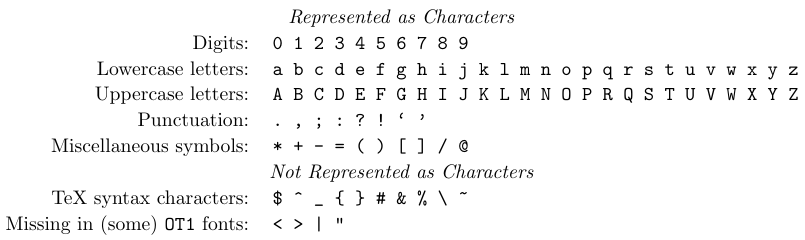
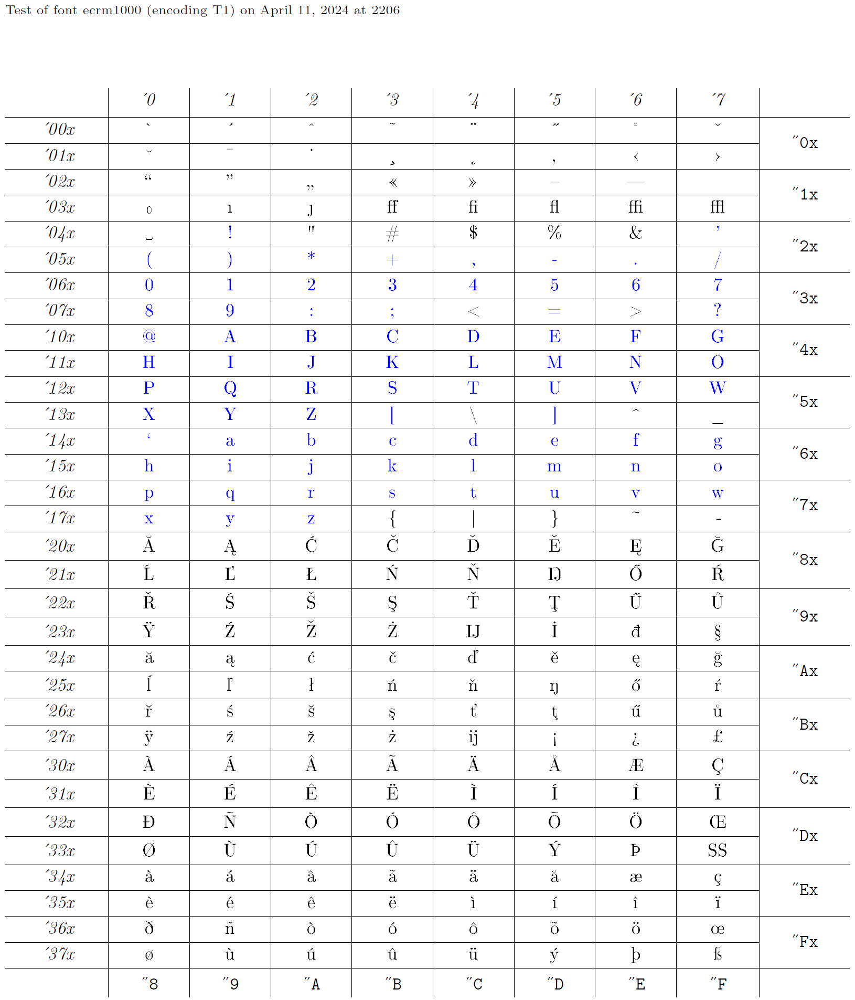
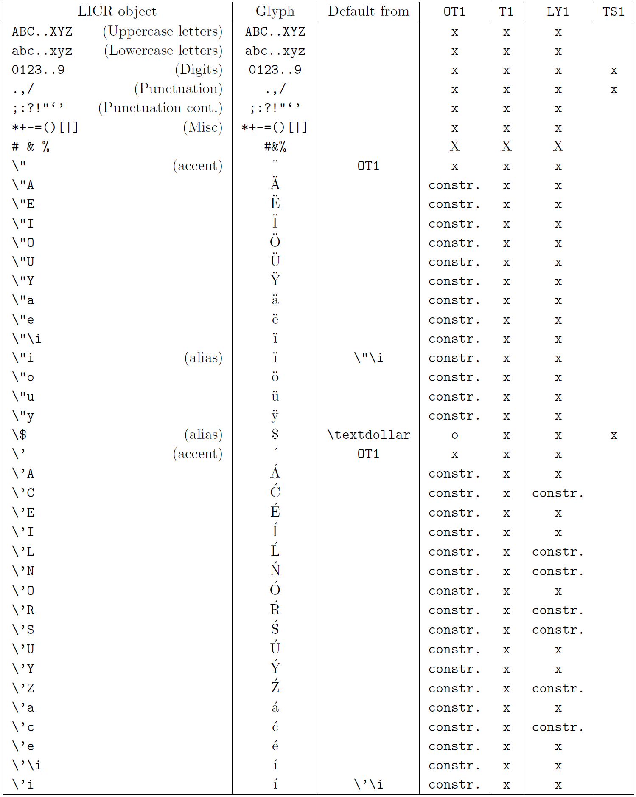
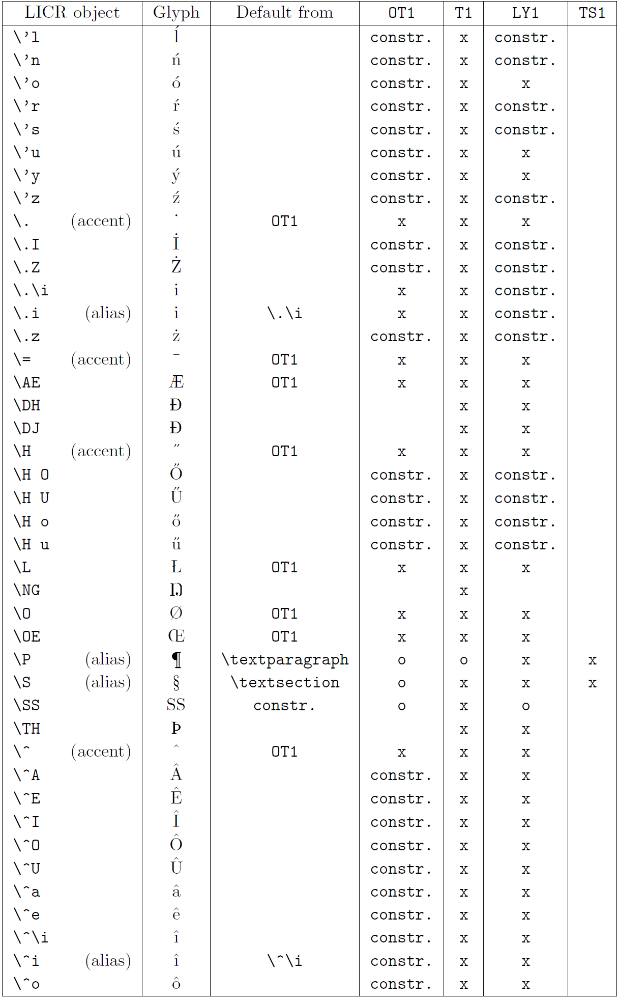
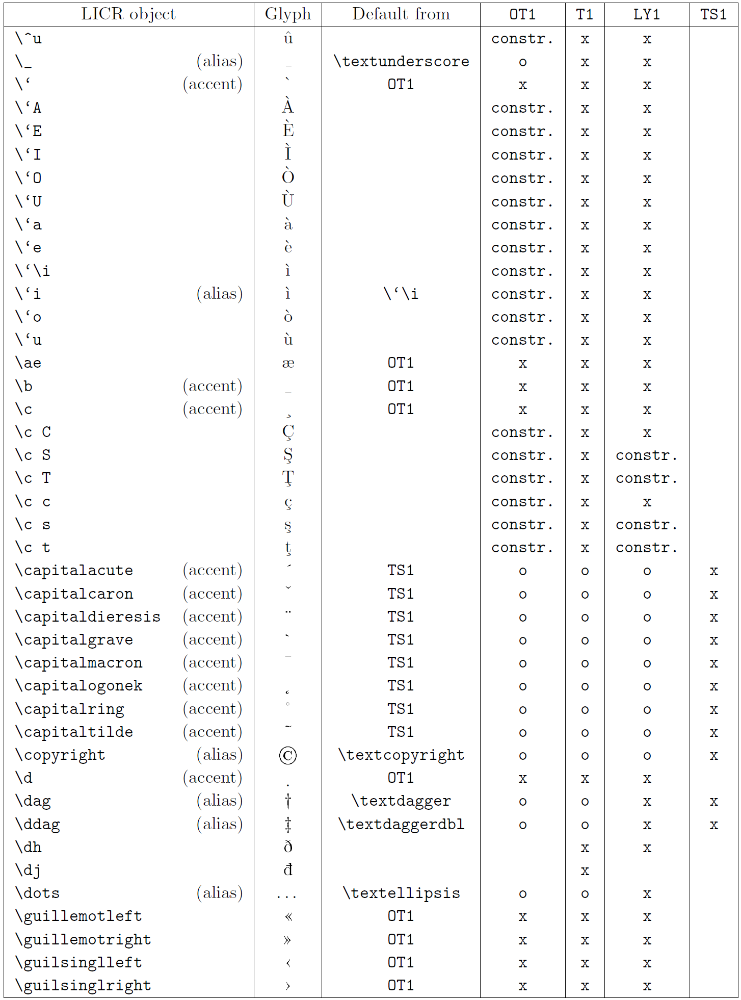
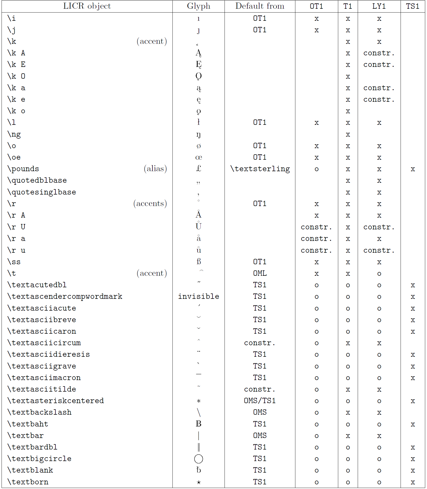
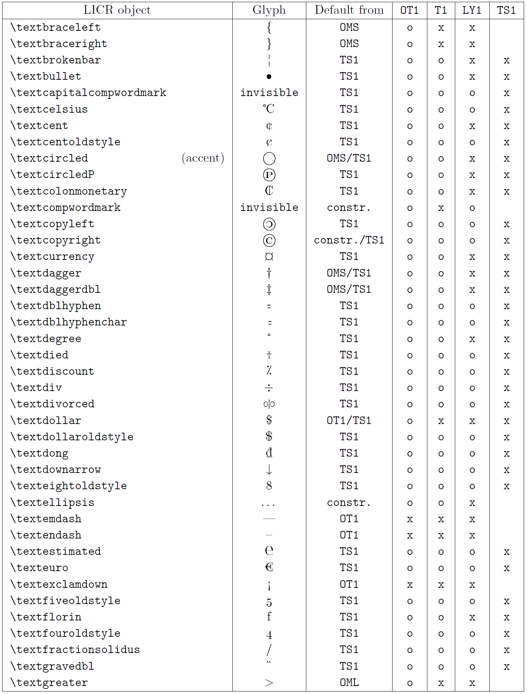
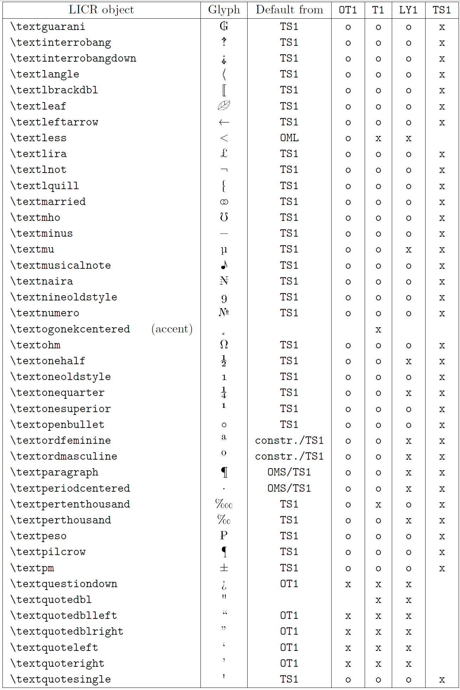
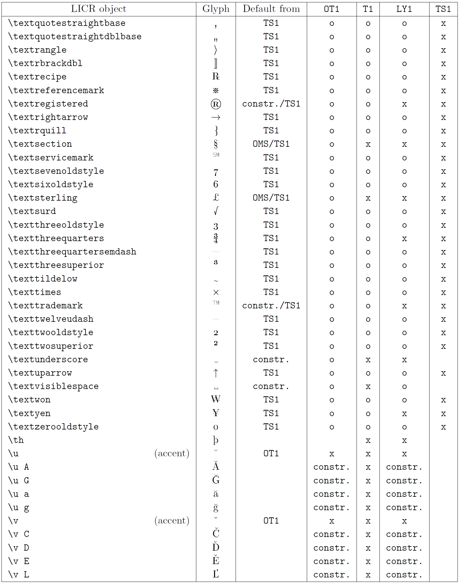
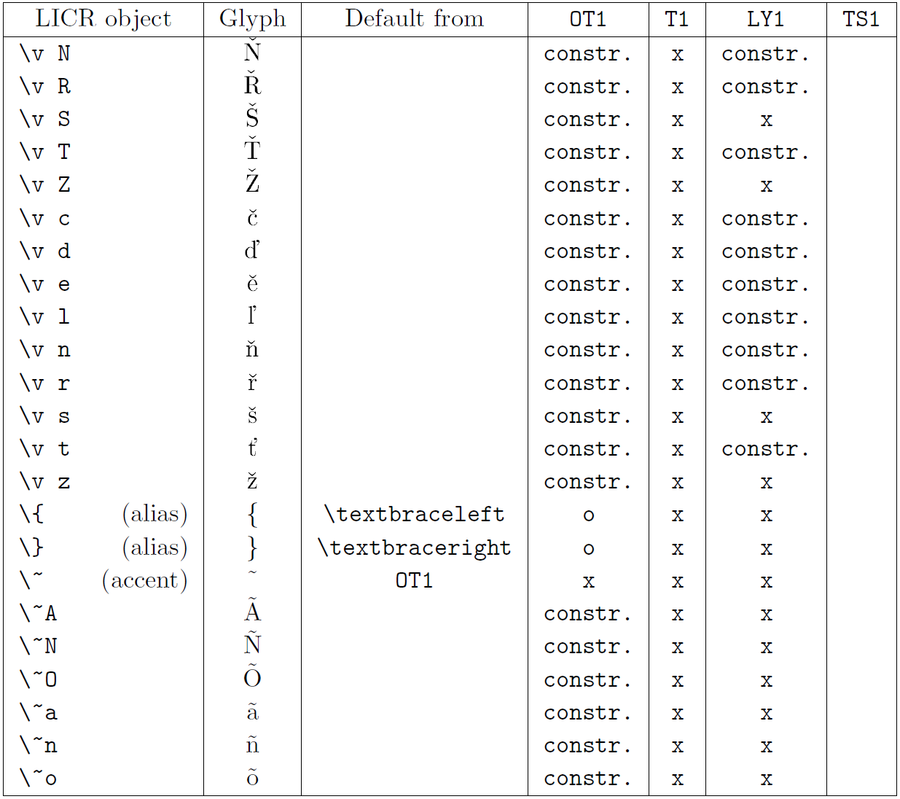

This article covers LaTeX encodings in detail. It starts with a discussion of the character data flow within the LaTeX system. Next, we take a closer look at the internal representation model for character data within LaTeX, followed by a discussion of the mechanisms used to map incoming data via input encodings into that internal representation. Finally, we explain how the internal representation is translated, via the output encodings, into the form required for typesetting.

## 7.1. The character data flow within LaTeX

Processing a document with LaTeX starts by interpreting data present in one or more source files. This data representing the document content is stored in source files as sequences of octets representing characters. To correctly interpret these octets, any program (including LaTeX) used to process the file must know the mapping between abstract characters and the octets representing them. In other words, it must know the encoding that was used when the file was written.

With an incorrect mapping, all further processing will be more or less erroneous unless the file contains only characters of a subset common in both correct and incorrect encodings.
LaTeX makes a fundamental assumption at this point: almost all visible ASCII characters (decimal 32-126) are represented by the number that they have in the ASCII code table.



One reason for this assumption is that most 8-bit encodings in use today share a common 7-bit plane. Another reason is that, to effectively use TeX, the majority of the visible portion of ASCII needs to be processed as characters of category *letter* - since only characters with this category can be used in multiple-character command names in TEX - or category *other* - since TEX will not, for example, recognize the decimal digits as being part of a number if they do not have this category code.

When a character (or, more precisely, an 8-bit number) is declared to be of category *letter* or *other* in TeX, then this 8-bit number will be transparently passed through TeX. That means TeX will typeset whatever symbol is in the font at the position addressed by that number.

As a consequence of the aforementioned assumption, fonts intended to be used for general text require that (most of) the visible ASCII characters be present in the font and encoded according to the ASCII encoding.

All other 8-bit numbers (those outside visible ASCII) potentially present in the input file are assigned a category code of *active*, which causes them to act like commands inside TeX. Therefore, LaTeX can transform them via the input encodings into a form that we will call the *LaTeX internal character representation (LICR)*.

As for Unicode's UTF8 encoding, it is handled similarly. The ASCII characters represent themselves, and the starting octets for multi-byte representation act as active characters that scan the input for the remaining octets. The result will be turned into an object in the LICR if it is mapped, or LaTeX will throw an error if the given Unicode character is not mapped.

The most important thing about objects in the LICR is that the representation of 7-bit ASCII characters is invariant to any encoding change, because all input encodings are supposed to be transparent with respect to visible ASCII. 

The output (or font) encodings serve then to map the internal character representations to glyph positions in the current font used for typesetting or, in some cases, to initiate more complex actions. For example, it may place an accent (present in one position in the current font) over some symbol (in a different position in the current font) to get a printed image of the abstract character represented by the command(s) in the internal character encoding.

The LICR encodes all possible characters addressable within LaTeX. Thus, it is much larger than the number of characters that can be represented by a single TeX font (which can contain at most 256 glyphs). In some case, a character in the internal encoding can be rendered with a font by combining glyphs, such as accented characters. However, when the internal character requires a special shape, there is no way to fake it if that glyph is not present in the font.

Nevertheless, the LaTeX's model for character encodings supports automatic mechanisms for fetching glyphs from different fonts, so that characters missing in the current font will get typeset, provided a suitable additional font containing them is available.

## 7.2. LaTeX's internal character representation (LICR)

Text characters are represented internally by LaTeX in one of three ways.

### Representation as characters

A small number of characters are represented by "themselves". For example, the Latin A is represented as the character 'A'. Such characters are shown in the table above. They form a subset of visible ASCII, and inside TeX, all of them are assigned the category code of *letter* or *other*. Some characters from the visible ASCII range are not represented in this way, either because they are part of the TeX syntax or because they are not present in all fonts. If one uses, for example, '<' in text, the current font encoding determines whether one gets `<` (`T1`) or perhaps an inverted exclamation mark (`OT1`) in the printed output.

### Representation as character sequences

TeX's internal ligature mechanism can generate new characters from a sequence of input characters. This is actually a property of the font, although some such sequences have been explicitly designed to serve as input shortcuts for characters that are otherwise difficult to address with most keyboards. Only a few characters generated in this way are considered to belong to LaTeX's internal representation. These include the en dash and em dash, which are generated by the ligatures `--` and `---`, and the opening and closing double quotes, which are generated by ``` `` ``` and `''` (the latter can usually also be represented by the single `"`). While most fonts also implement ``` !` ``` and ``` ?` ``` to generate inverted exclamation and question marks, this is not universally available in all fonts. This is why **all** such characters have an alternative internal representation as a command (e.g., `\textendash` or `\textexclamdown`).

### Representation as "font-encoding-specific" commands

The third way to represent characters internally in LaTeX, which covers the majority of characters, is with special LaTeX commands (or command sequences) that remain unexpanded when written to a file or when placed into a moving argument. We will refer to such special commands as *font-encoding-specific commands* because their meaning depends on the font encoding currently used when LaTeX is ready to typeset them. Such commands are declared using special declarations, as we will discuss below, that usually require individual definitions for each font encoding. If no definition exists for the current encoding, either a default is used (if available) or an error message is presented to the user.

When the font encoding is changed at some point in the document, the definitions of the encoding-specific commands do not change immediately, since that would mean changing a large number of commands on the spot. Instead, these commands are implemented in such a way that once they are used, they notice if their current definition is no longer suitable for the font encoding in force. In such a case, they call their counterparts in the current font encoding to do the actual work.

The set of font-encoding-specific commands is not fixed but is implicitly defined as the union of all commands defined for individual font encodings. Thus, new font-encoding-specific commands may be required when new font encodings are added to LaTeX.

## 7.3. Input encodings

Once the `inputenc` package is loaded, the two declarations `\DeclareInputText` and `\DeclareInputMath` for mapping 8-bit input characters to LICR objects become available. They should be used only in encoding files (see below), packages, or, if necessary, in the document preamble.

These commands take an 8-bit number as their first argument, which can be given as either a decimal number, octal number, or in hexadecimal notation. Using the decimal notation is advised since the characters `'` and/or `"` may get special meanings in a language support package, such as shortcuts to accents, thereby making octal and/or hexadecimal notation invalid if packages are loaded in the wrong order.

```tex
\DeclareInputText{number}{LICR-object}
```

The `\DeclareInputText` command declares character mappings for use in text. Its second argument contains the encoding-specific command (or command sequence), that is the LICR objects to which the character number should be mapped. For example,

```tex
\DeclareInputText{239}{\"\i}
```

maps the number `239` to the encoding-specific representation of the 'i-umlaut', which is `\"\i`. Input characters declared in this way cannot be used in math formulas.

```tex
\DeclareInputMath{number}{math-object}
```

If the number represents a character for use in math formulas, then the declaration `\DeclareInputMath` must be used. For instance, in the input encoding `cp437de` (German MS-DOS keyboard),

```tex
\DeclareInputMath{224}{\alpha}
```

maps the number `224` to the command `\alpha`. It is important to note that this declaration would make the key producing this number usable only in math mode, as `\alpha` is not allowed anywhere else.

```tex
\DeclareUnicodeCharacter{hex-number}{LICR-object}
```

This declaration is available only if the option `utf8` is used. It maps Unicode numbers to LICR objects (i.e., characters usable in text). For example, 

```tex
\DeclareUnicodeCharacter{00A3}{\textsterling}
\DeclareUnicodeCharacter{011A}{\v E}
\DeclareUnicodeCharacter{2031}{\textpertenthousand}
```

In theory, there should be only one unique bidirectional mapping between the two spaces, so that all such declarations could be already automatically made when the `utf8` option is selected. In practice, things are a little more complicated. Firstly, providing the whole table automatically would require a huge amount of TeX's memory. Additionally, there are many Unicode characters for which no LICR object exists, and conversely, many LICR objects have no equivalent in Unicode. This problem is solved in the `inputenc` package by loading only those Unicode mappings that correspond to the encodings used in a particular document (as far as they are known) and responding to any other request for a Unicode character with a suitable error message. It then becomes the user's task to either provide the right mapping information or, if necessary, load an additional font encoding.

As we mentioned above, the input encoding declarations can be used in packages or in the document preamble. To make everything work this way, it is important to load the `inputenc` package first, thereby selecting a suitable encoding. Subsequent input encoding declarations will act as a replacement for (or addition to) those defined by the present input encoding.

When using the `inputenc` package, you may see the command `\@tabacckludge`, which stands for "tabbing accent kludge". It is needed because the current version of LaTeX inherited an overloading of the commands `\=`, ``` \` ```, and `\'`, which normally denote certain accents (i.e., are encoding-specific commands), but have special meanings inside the `tabbing` environment. That is why mappings that involve any of these accents need to be encoded in a special way. For instance, if you want to map `232` to the 'e-grave' character (which has the internal representation ``` \`e ```), you should write

```tex
\DeclareInputText{232}{\@tabacckludge`e}
```

instead of 

```tex
\DeclareInputText{232}{\`e}
```

### Mapping to text and/or math

For technical and conceptual reasons, TeX makes a very strong distinction between characters that can be used in text and in math. Except for visible ASCII characters, commands that produce characters can normally be used in either text or math mode, but not in both modes.

### Input encoding files for 8-bit encodings

Input encodings are stored in files with the extension `.def`, where the base name is the name of the input encoding (e.g., `latin1.def`). Such files should contain only the commands discussed in the current section.
The file should start with an identification line that contains the `\ProvidesFile` command, describing the nature of the file. For instance:

```tex
\ProvidesFile{latin1.def}[2000/07/01 v0.996 Input encoding file]
```

If there are mappings to encoding-specific commands that might not be available unless additional packages are loaded, one could declare defaults for them using `\ProvideTextCommandDefault`. For example:

```tex
\ProvideTextCommandDefault{\textonehalf}{\ensurement{\frac12}}
\ProvideTextCommandDefault{\textcent}{\TextSymbolUnavailable\textcent}
```

The command `\TextSymbolUnavailable` issues a warning indicating that a certain character is not available with the currently used fonts. This can be useful as a default when such characters are available only if special fonts are loaded and there is no suitable way to fake the characters with existing characters (as was possible for a default for `\textonehalf`).

The remainder of the file should include only input encoding declarations `\DeclareInputText` and `\DeclareInputMath`. As mentioned above, the use of the latter command is discouraged but allowed. No other commands should be used inside an input encoding file, in particular, no commands that prevent reading the file multiple times (e.g., `\newcommand`), since the encoding files are often loaded multiple times in a single document.

### Input mapping files for UTF8

As mentioned earlier, the mapping from Unicode to LICR objects is organized in a way that enables LaTeX to load only those mappings that are relevant for the font encodings used in the current document. This is done by trying to load for each encoding <*name*> a file <*name*>`enc.dfu` that, if exists, contains the mapping information for those Unicode characters provided by that particular encoding. Besides a number of `\DeclareUnicodeCharacter` declarations, such files should include only a `\ProvidesFile` line.

Since different font encodings often provide more or less the same characters, it is quite common for declarations for the same Unicode character to appear in different `.dfu` files. Therefore, it is very important that these declarations in different files be identical. Otherwise, the declaration loaded last will survive, which may be a different one from document to document.

So, anyone who wants to provide a new `.dfu` file for some encoding that was previously not covered should carefully check the existing definitions in `.dfu` files for related encodings. Standard files provided with `inputenc` are guaranteed to have uniform definitions. In fact, they are all generated from a single list that is suitably split up. A full list of currently existing mappings can be found in the file `utf8enc.dfu`.

## 7.4. Output encodings

We have already mentioned that output encodings define the mapping from the LICR to the glyphs (or constructs built from glyphs) available in the fonts used for typesetting. These mappings are referenced inside LaTeX by two- or three-letter names (e.g., `OT1` and `T3`). We say that a certain font is in a certain encoding if the mapping corresponds to the positions of the glyphs in the font. Let us now take a look at the exact components of such a mapping.

Characters internally represented by ASCII characters are simply passed on to the font. In other words, TeX uses the ASCII code to select a glyph from the current font. For example, the character 'A' with ASCII code 65 will result in typesetting the glyph in position 65 in the current font. This is why LaTeX requires fonts for text to contain all such ASCII letters in their ASCII code positions, since there is no way to interact with this basic TeX mechanism. Therefore, for visible ASCII, a one-to-one mapping is implicitly present in all output encodings.

Characters internally represented as sequences of ASCII characters (e.g., "`--`") are handled as follows: when the current font is first loaded, TeX is informed that the font contains a number of so-called ligature programs. These programs define certain character sequences that should not be typeset directly but rather to be replaced with some other glyphs from the font. For example, when TeX encounters "`--`" in the input (i.e., ASCII code 45 twice), a ligature program may direct it to the glyph in position 123 instead (which would then hold the en dash glyph). Again, there is no way to interact with this mechanism.

Nevertheless, the biggest part of the internal character representation consists of font-encoding-specific commands that are mapped using the declarations described below. All declarations have the same structure in their first two arguments: the font-encoding-specific command (or the first component of it, if it is a command sequence), followed by the name of the encoding. Any remaining arguments will depend on the declaration type.

So, an encoding `XYZ` is defined by a bunch of declarations, all having the name `XYZ` as their second argument. Then, of course, some fonts must be encoded in that encoding. In fact, the development of font encodings is normally done reversely - someone starts with an existing font and then provides appropriate declarations for using it. This collection of declarations is then given a suitable name, such as `OT1`. Below, we will take the font `ecrm1000` (see the glyph chart), whose font encoding is called `T1` in LaTeX, and build appropriate declarations to access glyphs from a font encoded in this way. The blue characters in the glyph chart are those that should be present in the same position in every text encoding, as they are transparently passed through LaTeX.



### Output encoding files

Output encoding files are identified by the same `.def` extension as input encoding files. However, the base name of the file is a little more structured. It consists of the encoding name in lowercase letters, followed by `enc` (e.g., `t1enc.def` for the `T1` encoding).

These files should include only declarations described in the current section. Since output encoding files may be read multiple times by LaTeX, it is important to follow this rule and to refrain from using, for example, `\newcommand`, which prevents reading such a file more than once!

Again, an output encoding file starts with an identification line describing the nature of the file. For example:

```tex
\ProvidesFile{t1enc.def}[2001/06/05 v1.94 Standard LaTeX file]
```

Before we declare any encoding-specific commands for a particular encoding, we first have to make this encoding known to LaTeX. This is done via the `\DeclareFontEncoding` command. At this point, it is also useful to declare the default substitution rules for the encoding. We can do so by using the command `\DeclareFontSubstitution`. Both declarations are discussed in detail in [How to set up new fonts](/tex/java/latex-fonts-setup/).

```tex
\DeclareFontEncoding{T1}{}{}
\DeclareFontSubstitution{T1}{cmr}{m}{n}
```

Now that we have introduced the `T1` encoding to LaTeX in this way, we can proceed with declaring how font-encoding-specific commands should behave in that encoding.

```tex
\DeclareTextSymbol{LICR-Object}{encoding}{slot}
```

The declaration for text symbols seems to be the simplest. Here, the internal representation can be directly mapped to a single glyph in the target font. This is achieved by using the `\DeclareTextSymbol` declaration, whose third argument - the glyph position - can be given as a decimal, octal, or hexadecimal number. For example,

```tex
\DeclareTextSymbol{\ss}{T1}{255}
\DeclareTextSymbol{\AE}{T1}{'306} %font position as octal number
\DeclareTextSymbol{\ae}{T1}{"E6} %...as hexadecimal number
```

declare that the font-encoding-specific commands `\ss`, `\AE`, and `\ae` should be mapped to the font (decimal) positions 255, 198, and 230, respectively, in a `T1`-encoded font. As we mentioned above, it is safest to use decimal notation in such declarations. Anyway, mixing notations as in the previous example is certainly bad style.

```tex
\DeclareTextAccent{LICR-accent}{encoding}{slot}
```

Fonts often contain diacritical marks as individual glyphs to allow the construction of accented characters by combining such a diacritical mark with some other glyph. Such accents (as long as they are to be placed on top of other glyphs) are declared using the `\DeclareTextAccent` command. The third argument, *slot*, is the position of the diacritical mark in the font. For instance,

```tex
\DeclareTextAccent{\"}{T1}{4}
```

defines the "umlaut" accent. From that point onward, an internal representation such as `\"a` has the following meaning in the `T1` encoding: typeset 'a with umlaut' by placing the accent in position 4 over the glyphs in position 97 (the ASCII code of the character `a`). Such a declaration, in fact, implicitly defines a huge range of internal character representations - that is, anything of type `\"`*<base-glyph>*, where *<base-glyph>* is something defined via `\DeclareTextSymbol` or any ASCII character belonging to the LICR, such as 'a'.

Even those combinations that do not make much sense, such as `\"\P` (i.e., pilcrow sign with umlaut), conceptually become members of the set of font-encoding-specific commands in this way.

```tex
\DeclareTextComposite
     {LICR-accent}{encoding}{simple-LICR-object}{slot}
```

The glyph chart above contains a large number of accented characters as individual glyphs - for example, 'a with umlaut' in position `'240` octal. Thus, in `T1` the encoding-specific command `\"a` should not result in placing an accent over the character 'a', but instead should directly access the glyph in that position of the font. This is achieved by the declaration

```tex
\DeclareTextComposite{\"}{T1}{a}{228}
```

which states that the encoding-specific command `\"a` results in typesetting the glyph 228, thereby disabling the accent declaration above. For all other encoding-specific commands starting with `\"`, the accent declaration remains in place. For example, `\"b` will produce a 'b with umlaut' by placing an accent over the base glyph 'b'.

The third argument, *simple-LICR-object*, should be a single letter, such as 'a', or a single command, such as `\j` or `\oe`.

```tex
\DeclareTextCompositeCommand
     {LICR-object}{encoding}{simple-LICR-object}{code}
```

Although it is not used for the `T1` encoding, there is also a more general version of `\DeclareTextComposite` that allows arbitrary code in place of a slot position. This is used, for example, in the `OT1` encoding to lower the ring accent over the 'A' compared to the way it would be typeset with TeX's `\accent` primitive. The accents over the 'i' are also implemented using this form of declaration:

```tex
\DeclareTextCompositeCommand{\'}{OT1}{i}{\@tabacckludge'\i}
\DeclareTextCompositeCommand{\^}{OT1}{i}{\^\i}
```

A number of diacritical marks are not placed on top of other characters but rather placed somewhere below them. There is no special declaration form for such marks, as the actual positioning of the accent involves low-level TeX code. Instead, the generic `\DeclareTextCommand` can be used for this purpose.

```tex
\DeclareTextCommand{LICR-object}{encoding}[num][default]{code}
```

For example, the 'underbar' accent `\b` in the `T1` encoding is defined with the following code:

```tex
\DeclareTextCommand{\b}{T1}[1]
     {\hmode$bgroup\o$lign{\relax#1\crcr\hidewidth\sh$ft{29}%
           \vbox to.2ex{\hbox{\char9}\vss}\hidewidth}\egroup}
```

In this discussion, it does not matter much what the code exactly means, but we can see that `\DeclareTextCommand` is similar to `\newcommand` in a way. It has an optional *num* argument denoting the number of arguments (one here), a second optional *default* argument (not present here), and a final mandatory argument containing the code in which it is possible to refer to the argument(s) using `#1`, `#2`, and so on.

`\DeclareTextCommand` can also be used to build font-encoding-specific commands consisting of a single control sequence. In this case, it is used without the optional argument, thus defining a command with zero arguments. For instance, in `T1` there is no glyph for a 'per thousand' sign, but there is a little 'o' in position `'30`, which, if placed directly behind a '%', will give the appropriate glyph. Thus, we can provide the following declarations:

```tex
\DeclareTextCommand{\textperthousand} {T1}{\%\char 24}
\DeclareTextCommand{\textpertenthousand}{T1}{\%\char 24\char 24 }
```

We have now covered all commands needed to declare the font-encoding-specific commands for a new encoding. As we have already said, only these commands should be present in encoding definition files.

### Output encoding defaults

Let's see now what happens if an encoding-specific command, for which there is no declaration in the current font encoding, is used. In that case, one of two things may happen: either LaTeX has a default definition for the LICR object, in which case this default is used, or an error message is issued stating that the requested LICR object is unavailable in the current encoding. There are a number of ways to set up defaults for LICR objects.

```tex
\DeclareTextCommandDefault{LICR-object}[num][default]{code}
```

The `\DeclareTextCommandDefault` command provides the default definition for an *LICR-object* to be used whenever there is no specific setting for an object in the current encoding. Such definitions can, for example, fake a certain character. For instance, `\textregistered` has a default definition in which the character is built from two others, like this:

```tex
\DeclareTextCommandDefault{\textregistered}{\textcircled{\scshape r}}
```

Technically, default definitions are stored as an encoding with the name `?`. While you should not rely on this fact, as the implementation may change in the future, it means that you cannot declare an encoding with this name.

```tex
\DeclareTextSymbolDefault{LICR-object}{encoding}
```

In most cases, a default definition does not require coding but simply directs LaTeX to take the character from some encoding in which it is known to exist. The `textcomp` package, for example, contains a large number of default declarations that all point to the `TS1` encoding. For instance:

```tex
\DeclareTextSymbolDefault{\texteuro}{TS1}
```

The `\DeclareTextSymbolDefault` command can be used to define the default for any LICR object without arguments, not just those declared with the `\DeclareTextSymbol` command in other encodings.

```tex
\DeclareTextAccentDefault{LICR-accent}{encoding}
```

There is a similar declaration for LICR objects that take one argument, such as accents. Again, this form is usable for any LICR object with one argument. The LaTeX kernel, for example, contains a number of declarations of the type:

```tex
\DeclareTextAccentDefault{\"}{OT1}
\DeclareTextAccentDefault{\t}{OML}
```

This means that if the `\"` is not defined in the current encoding, then use the one from an `OT1`-encoded font. Similarly, to get a tie accent, pick it up from `OML` if nothing better is available.

```tex
\ProvideTextCommandDefault{LICR-object}[num][default]{code}
```

The `\ProvideTextCommandDefault` declaration allows for "providing" another kind of default. It does the same job as the `\DeclareTextCommandDefault` declaration, except that the default is provided only if no default has been defined before. This is mainly used in input encoding files to provide some sort of trivial defaults for unusual LICR objects. For instance:

```tex
\ProvideTextCommandDefault{\textonequarter}{\ensuremath{\frac14}}
\ProvideTextCommandDefault{\textcent}{\TextSymbolUnavailable\textcent}
```

Packages like `textcomp` can then replace such definitions with declarations pointing to real glyphs. Using `\Provide...` instead of `\Declare...` ensures that a better default is not accidentally overwritten if the input encoding file is read.

```tex
\UndeclareTextCommand{LICR-object}{encoding}
```

In some cases, an existing declaration needs to be removed to ensure that a default declaration is used instead. This can be done by using the `\UndeclareTextCommand`. For example, the `textcomp` package removes the definitions of `\textdollar` and `\textsterling` from the `OT1` encoding because not every `OT1`-encoded font actually has these symbols.

```tex
\UndeclareTextCommand{\textsterling}{OT1}
\UndeclareTextCommand{\textdollar} {OT1}
```

Without this removal, the new default declarations to pick up the symbols from `TS1` would not be used for fonts encoded with `OT1`.

```tex
\UseTextSymbol{encoding}{LICR-object}
\UseTextAccent{encoding}{LICR-object}{simple-LICR-object}
```

The action hidden behind the declarations `\DeclareTextSymbolDefault` and `\DeclareTextAccentDefault` can also be used directly. Let's assume, for example, that the current encoding is `U`. In that case,

```tex
\UseTextSymbol{OT1}{\ss}
\UseTextAccent{OT1}{\'}{a}
```

has the same effect as entering the code below. Note in particular that the `a` is typeset in encoding `U` - only the accent is taken from the other encoding.

```tex
{\fontencoding{OT1}\selectfont\ss}
{\fontencoding{OT1}\selectfont\'{\fontendcoding{U}\selectfont a}}
```

### A listing of standard LICR objects

The table in this subsection provides an overview of the LaTeX internal representations available with the three major encodings for Latin-based languages: `OT1` (the original TeX encoding), `T1` (the LaTeX standard encoding), and `LY1` (an alternate 8-bit encoding proposed by Y&Y). Additionally, it shows all LICR objects declared by `TS1` (the LaTeX standard text symbol encoding) provided by loading the `textcomp` package.

The first column of the table shows the LICR object names in alphabetical order, indicating which LICR objects act like accents. The second column shows a glyph representation of the object.

The third column describes whether the object has a default declaration. If an encoding is listed, it means that by default the glyph is being fetched from a suitable font in that encoding; `constr.` means that default is produced from low-level TeX code; if the column is empty, it means that no default is defined for this LICR object. In the last case, a "Symbol unavailable" error is returned when you use it in an encoding for which it has no explicit definition. If the object is an alias for some other LICR object, the alternative name is listed in this column.

Columns four through seven show whether an object is available in the given encoding. Here, 'x' means that the object is natively available (as a glyph) in fonts with that encoding, 'o' means that it is available through the default for all encodings, and `constr.` means that it is generated from several glyphs, accent marks, or other elements. If the default is fetched from `TS1`, the LICR object is available only if the `textcomp` package is loaded.

#### LICR objects. Part 1



#### LICR objects. Part 2



#### LICR objects. Part 3



#### LICR objects. Part 4



#### LICR objects. Part 5



#### LICR objects. Part 6



#### LICR objects. Part 7



#### LICR objects. Part 8

