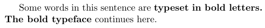
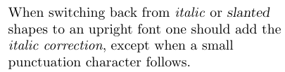
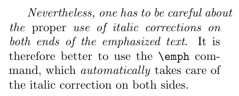
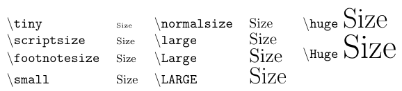
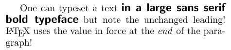
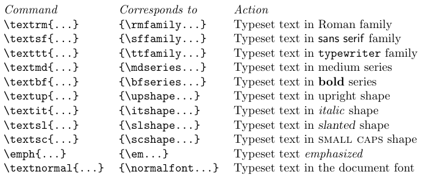
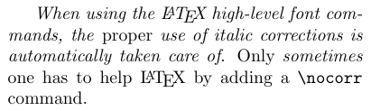
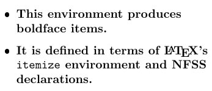
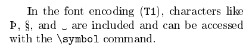
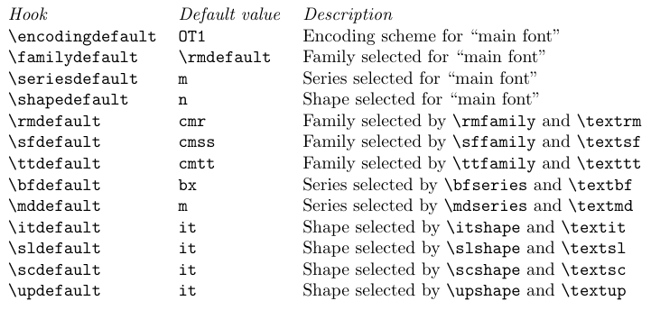

When you are writing a LaTeX document, the markup tags used to structure the document automatically choose appropriate fonts. For example, for a section heading, such font attributes as large size and bold weight are defined by the document class and applied when a `\section` command is used. Therefore, you rarely need to specify font attributes directly.

But sometimes it is necessary. For example, you may want to choose a different font family (or another overall font attribute) for the main text. Such alteration often can be done as simply as by specifying an appropriate package.

Another case is when you want to mark certain fragments of the document as special - for example, to denote acronyms, examples, or company names. If you choose to use, say, a sans serif font for these fragments, you can do so by surrounding company names with `\textsf{...}`. But the better practice is to define a new command (say, `\Company`) for this purpose. Defining individual commands for logically different things makes it easier to change the formatting later in a consistent way.

You might also want to typeset a table in a smaller size to make it fit on a page. Since document classes can format documents automatically only to a certain extent, this desire is legitimate. It follows that formatting by hand, like the insertion of page breaks, is often necessary to create a final version. Unfortunately, explicit formatting makes further use of the document difficult and error-prone. Therefore, the direct use of font-changing commands in a document should be minimized. This is also true for all visual formatting commands.


## 3.1. How to use font commands in standard LaTeX

The font used for the main text of a document is called the *main font*, *body font*, or *normal font*. It is automatically selected at the beginning of the document and in certain constructs, such as footnotes, and figures. Section headings and other logical markup tags automatically switch to a different typeface or size, depending on the document class. Therefore, introducing the correct logical markup is the only action required from the author. However, sometimes it may be desirable to manually highlight certain parts of the text by choosing an appropriate typeface. This is done with the commands discussed below.

There are two forms for most font-changing commands: a command with one argument, such as `\textbf{...}`, and a declaration, such as `\bfseries`. The declarative form takes no arguments but rather instructs LaTeX that from now on (up to the end of the current group of braces or environments) it should behave in a special way. This means that you should not write something like `\bfseries{...}`, because this would make everything bold from this point until the end of the current environment.

It is better to make use of the font commands with one argument to change the fonts for individual words or short phrases within your document. For longer fragments, you should use the environment form of the declaration, as shown in the example below:

```tex
Some words in this sentence are \begin{bfseries}typeset in bold letters.
The bold typeface\end{bfseries} continues here. 
```



The declarative forms themselves are often better in the definition of new environments or commands.

> It is also important that the font commands with one argument do not allow paragraph breaks in their arguments.

### The main document font

Using the command `\textnormal` or the declaration `\normalfont`, you can switch to the main document font. They typically occur only in the definitions of commands or environments when it is important to define a way to always typeset in the same font regardless of the surrounding conditions. For example, the command to typeset LaTeX command names would look as follows:

```tex
\newcommand\Lcs[1]{{\normalfont\ttfamily\textbackslash#1}%}
```

Using `\normalfont` prevents the command names coming out in italics even within the text typeset in italics.

### Standard font families

By default, LaTeX maintains three font families: a serifed text font, accessed with the command `\textrm`; a sans serif text font, accessed by `\textsf`; and a typewriter (monospaced) font, accessed by `\texttt`. The declaration forms of these commands are `\rmfamily`, `\sffamily`, and `\ttfamily`, respectively.

The exact names of the external font families accessed by these commands depend on the document class but can be changed in the preamble or by packages. As an installation default, the serifed font family is **Computer Modern Roman**, the sans serif family is **Computer Modern Sans**, and the typewriter family is **Computer Modern Typewriter**. If you use a different set-up, you should take care to define these default font families so that the fonts can be mixed without visual clashes. It is also important to make sure that external fonts are available in the correct resolution for the targeted output device.

Most document classes set the serifed font, accessed by `\textrm`, as the main font of the document, so the command `\textrm` is not used often. But if a document designer has chosen a sans serif font as the main typeface, the `\textrm` would be the alternative serifed font family.

### Standard font series

In LaTeX, the *series* is a combination of two attributes: width and weight (boldness). LaTeX allows changing the series with two commands: `\textmd` and `\textbf`. The corresponding declarations are `\mdseries` and `\bfseries`, respectively. The first command selects a font with medium values for the width and the weight, while the latter switches to a bolder series. Again, the actual values depend on the document class and its options or subsequent packages. In a default set-up, `\textbf` switches to a bold extended version of the current typeface, while `\textmd` returns to the medium width and medium weight version of the current typeface.

### Standard font shapes

The *shape* of the current typeface is the third font attribute that may be changed independently of the others. The default shape for most documents is the upright shape, which can be accessed with the `\textup` command or the `\upshape` declaration if necessary.

The most commonly used commands seem to be `\textit` and `\textsc`, which switch to an italic or small caps font shape, respectively. The corresponding declarations are `\itshape` and `\scshape`.

The `\textsl` command (its declaration form is `\slshape`) switches to the slanted shape. A font family often contains only an italic or a slanted shape, though Computer Modern Roman contains both.

At the point where one switches from slanted to upright, the characters usually come too close together, especially if the last slanted character has an ascender. The proper amount of extra space that should be added at this boundary is called the **italic correction**. The exact width of this space depends on the individual character and is stored in the `.tfm` file. The font commands with arguments automatically add the italic correction, but when declarations are employed, it must be inserted manually using `\/`. For an upright font, the italic correction of the characters is usually zero or very small, although there are some exceptions. The next example shows how to correctly use shape-changing declarations that switch to slanted shapes.

```tex
\raggedright
When switching back from {\itshape italic\/} or {\slshape slanted\/} shapes to an upright font one
should add the {\itshape italic correction}, except when a small punctuation character follows.
```



Small caps are sometimes used in headings or to format names. For the latter case, you can, for example, define the command `\name` as follows:

```tex
\newcommand\name[1]{\textsc{#1}}
```

Alternatively, you can use two declarations:

```tex
\newcommand\name[1]{{\normalfont\scshape #1}}
```

The first command simply switches to the small caps shape, while the second form initially resets all font attributes to their defaults. Which option to choose depends on the available fonts and the type of document. With Computer Modern, only the Roman and Typewriter families contain small caps shapes, so the second definition might be preferred in certain applications because it will use small caps (though serifed) even in a `\sffamily` context. The first command would request a medium series, small caps, shaped font in the Computer Modern Sans family. This font is not available, so LaTeX would try to find a substitute by first changing the shape attribute to its default. As a result, you would not get small caps.

Another LaTeX special shape command is the `\emph` command, which emphasizes fragments in normal text. Its declarative form is `\em`. As a tradition, emphasized words in text are set in italics; but if emphasis is desired in an already italicized fragment of the text, one usually switches back to the upright font. The `\emph` command supports this convention by switching to the `\itshape` shape if the current font is upright, and to the `\upshape` shape if the current font is already slanted (i.e., if the shape is `\itshape` or `\slshape`). So, the user does not have to worry about the current state of the text when using the `\emph` command or the `\em` declaration.

```tex
{\em Nevertheless, one has to be careful about the\/ {\em proper\/} use of italic corrections
on both ends of the emphasized text}. It is therefore better to use the \verb=\emph= command,
which \emph{automatically} takes care of the italic correction on both sides.
```



### Standard font sizes

There are 10 size-changing commands in LaTeX. These commands have no corresponding command forms with one argument since font size changes are normally used only in the definitions of commands.



The size selected by these commands depends on the settings in the document class and possibly on options (e.g., `11pt`) specified with it. In general, `\normalsize` corresponds to the main size of the document, and the size-changing commands form an ordered sequence starting with `\tiny` as the smallest and going up to `\Huge` as the largest size. It can happen that more than one command refers to the same size. For example, when a large `\normalsize` is chosen, `\Huge` can be the same as `\huge`. But the order is always honored though.

The size-changing commands for the main text sizes (i.e., `\normalsize`, `\small`, and `\footnotesize`) typically affect the spacing around lists and displays. Therefore, to change their behavior, one should not simply replace their definition by a call to `\fontsize`, but instead start from their original definition, as documented in `classes.dtx`.

## 3.2. How to combine standard font commands

As already shown, the standard font-changing commands and declarations can be combined, resulting in the selection of a typeface that matches the combination of font attributes. See the example below:

```tex
One can typeset a text {\sffamily\bfseries\large in a large sans serif
bold typeface} but note the unchanged leading! \LaTeX{} uses the value
in force at the \emph{end} of the paragraph!
```



Internally, the `\sffamily` command switches to the sans serif default family, then `\bfseries` switches to the default bold series in this family, and finally `\large` selects a large size but leaves all other attributes unchanged. The leading appears to be unchanged because the scope of `\large` ends before the end of the paragraph. Font metric files are loaded for all intermediate typefaces, even if these fonts are never used. In the example above, they would be "sans serif medium 10pt" after the `\sffamily`, then "sans serif bold extended 10pt" after the `\bfseries`, and, finally, "sans serif bold extended 14pt", which is the font that is actually used. Therefore, such high-level commands can force LaTeX's font selection to unnecessarily load fonts that are never used. There is only a small loss of processing speed when a given combination is used for the first time. But if you have many different combinations of this type, you should better consider defining them in terms of [primitive font-changing declarations](/tex/java/latex-fonts-low-level/).

## 3.3. Font commands and declarations comparison

The font changing commands with arguments all start with `\text...` (except `\emph`) to emphasize that they are intended for use in normal text. Using such commands instead of the declarative forms has the advantage of maintaining consistency with other LaTeX constructs. They are intended for typesetting short pieces of text in a specific family, series, or shape. The following table shows the effect of these commands.



Another advantage of these commands is that they automatically insert any necessary italic correction on either side of their argument. Thus, you do not have to worry about missing italic corrections when changing fonts.

The italic correction inserted automatically is wrong in a very few situations. It is usually recommended to omit the italic correction if a small punctuation character (a comma or a period) directly follows the font change. You can define in which cases the italic correction should be suppressed. This is done by specifying the characters that should cancel a preceding italic correction in the list `\nocorrlist`. The default definition for this command is

```tex
\newcommand{\nocorrlist}{,.}
```

It is also possible to suppress the italic correction in individual instances. For this purpose, the command `\nocorr` is provided. Note that you have to put `\nocorr` on the left or right end inside the argument of the `\text...` commands, depending on which side of the fragment needs the suppression of the italic correction.

```tex
\emph{When using the \LaTeX{} high-level font commands, the \emph{proper} use of
italic corrections is automatically taken care of}. Only \emph{sometimes} one has
to help \LaTeX{} by adding a \verb=\nocorr= command.
```



In contrast, the declaration forms are often more suitable for defining your own commands or environments.

```tex
% Part of the preamble
\newenvironment{bfitemize}{\begin{itemize}%
  \normalfont\bfseries\raggedright}{\end{itemize}}
-----------------------------------------------
\begin{bfitemize}
\item This environment produces boldface items.
\item It is defined in terms of \LaTeX's
\texttt{itemize} environment and NFSS declarations.
\end{bfitemize}
```



## 3.4. How to access all characters of a font

Even if a character exists in a font, sometimes it is impossible to enter it from the keyboard. Many useful characters are accessible via commands like `\ss` or `\AE`. Some characters can be implicitly generated from sequences of letters like `ffi`, which produces the "ffi" ligature, and `---`, which produces the long dash in the standard TeX fonts.

In addition, the `\symbol` command allows you to access any character in a font by giving its number in the current encoding scheme as either decimal, octal (preceded by `'`), or hexadecimal (preceded by `"`) number.

```tex
\fontencoding{T1}\selectfont
-----------------------------------------------
In the font encoding (\texttt{T1}), characters like \symbol{"DE},
symbol{'237}, and \symbol{32} are included and can be accessed with
the \verb=\symbol= command.
```



## 3.5. How to change the default text fonts

If you want to easily modify the overall appearance of a document, you can use LaTeX's built-in hooks that modify the behavior of the high-level font-changing commands discussed earlier. The values of these hooks can be set in package files or in the preamble of a document by using `\renewcommand`. Here is the list of the hooks:



For example, if you write in the preamble

```tex
\renewcommand\familydefault{cmss}
```

a whole document would come out in Computer Modern Sans, because this redefinition changes the font family for the main font used by LaTeX. In detail, the main document font is determined by the values of `\encodingdefault`, `\familydefault`, `\seriesdefault`, and `\shapedefault`. This means that you have to make sure that these commands are defined in such a way that their combination points to an existing font shape in LaTeX's internal tables.

The default value of `\encodingdefault` (`OT1`) actually serves compatibility. This means that LaTeX assumes that most fonts use the original encoding. In most circumstances, it is better to use the `T1` encoding because it contains many additional glyphs that are not available with `OT1` and allows proper hyphenation for words with accented characters. Nowadays, some fonts do not support `OT1` at all since they are designed for use with `T1`.

It is important to remember that not every font can be used as a document-encoding default. A prerequisite is that the encoding must include most of the visible ASCII letters in their standard positions. The `\encodingdefault` can be changed by loading the `fontenc` package with one or more options.

The initial setting of `\familydefault` means that changing `\rmdefault` will implicitly change `\familydefault` to the new value, as long as no special setting for `\familydefault` is defined. But if `\familydefault` is changed, `\rmdefault` is not affected.
