By now we have discussed how to deal with individual formulas; but displays often involve a whole bunch of different formulas, or different pieces of a huge formula, and it may be a challenge to lay them out so that they line up properly with each other. Luckily, large displays generally fall into a few simple patterns.

### 9.1. One-line displays

Displayed equations often contain ordinary text. We have already [discussed](/tex/java/latex-math-fine-points/#82-non-italic-letters) how to get Roman type into formulas without leaving math mode, but the best way to get text into a display is to put it into an `\hbox`. There actually needn't even be any math at all. To type set


you can say `$$\hbox{Displayed text}$$`. But here's a more interesting example:

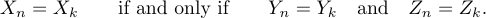

In this case, formulas and text were combined as follows:

```tex
$$\X_n=X_k \qquad\hbox{if and only if}\qquad
     Y_n=Y_k \quad\hbox{and}\quad Z_n=Z_k.$$
```

As you can see, `\qquad` appears around "if and only if", but a single `\quad` surrounds "and"; this makes an accent on the fact that the *Y* and *Z* parts of the display are related more closely to each other than to the *X* part. 

Let's look at the following display:

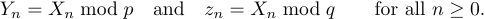

One way it can be specified is

```tex
$$Y_n=X_n\bmod p \quad\hbox{and}\quad z_n=X_n\bmod q
    \qquad\hbox{for all }n\ge0.$$
```

But the better way would be (see the second line)

```tex
$$Y_n=X_n\bmod p \quad\hbox{and}\quad z_n=X_n\bmod q
    \qquad\hbox{for all $n\ge0$.}$$
```

Yes, that's math mode inside of horizontal mode inside of display math mode, but this solution looks more natural than the first one.

Now let's turn to equation numbers, those little labels that appear off to the side of displays. If you type

```tex
$$<formula>\eqno<formula>$$
```

TeX will display the first formula and it will also put an equation number (the second formula) at the right-hand margin. For example,

```tex
$$x^2-y^2 = (x+y)(x-y).\eqno(15)$$
```

will produce

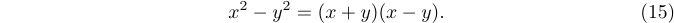

You can also get equation numbers at the left-hand margin by using `\leqno`. For example,

```tex
$$x^2-y^2 = (x+y)(x-y).\leqno(15)$$
```

will produce

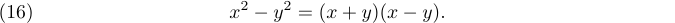

Notice that you always give the equation number second, even when it is going to appear at the left.

Displayed equations are centered regardless of the presence of the equation numbers. But when a formula is large, TeX makes sure that it doesn't interfere with its number; the equation number may even be placed on a line by itself.

LaTeX also provides the equation environment to automatically number your equations. For example, typing

```tex
\begin{equation}
  f(x)=(x+a)(x+b)
\end{equation}
```

results in

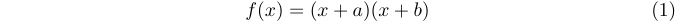

It's also possible to label and reference equations using `\label` and `\ref`. For example,

```tex
\begin{equation} \label{eq:someequation}
  f(x)=(x+a)(x+b)
\end{equation}
this references equation \ref{eq:someequation}.
```

results in

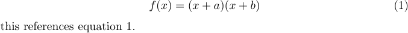

### 9.2. Multi-line displays

Sometimes a display may not fit the simple pattern of a one-line formula with or without an equation number. LaTeX provides special commands for most of the remaining cases.

Multi-line displays usually include several equations that should be lined up by their '=' signs, as in

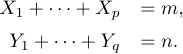

The recommended method for such a display is to use the `array` environment provided by LaTeX: 

```tex
$$\begin{array}{rl}
  X_1+\cdots+\X_p&=m,\\
  Y_1+\cdots+\Y_q&=n.}
\end{array}$$
```

This environment helps you to represent your equations as a multi-column (two columns in this case) rectangular array. The rows contain individual equations separated by the `\\` (which is a newline) command. The left-hand and right-hand sides of each equation are separated by the `&` symbol. It is not required that the last line ends with `\\`. The environment also has an argument that specifies the alignment in each column. In the example, the appropriate value is `rl`, which means that the left-hand sides of the equations will come out flush right, while the right-hand sides will come out flush left.

LaTeX also provides the `eqnarray*` environment that works similarly, but to have both sides of equations properly aligned it needs two alignment points, and unfortunately, the spacing becomes somewhat out of math typing conventions. The following code

```tex
\begin{eqnarray*}
  X_1+\cdots+X_p&=&m,\\
  Y_1+\cdots+Y_q&=&n.
\end{eqnarray*}
```

produces the following output:

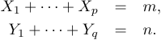

LaTeX's `eqnarray` environment produces the same result except that it automatically numbers the equations.

There can be any number of equations in an `array` environment; the general pattern is

```tex
\begin{array}{rl}
  <left-hand side_1>&<right-hand side_1>\\
  <left-hand side_2>&<right-hand side_2>\\
  ...
  <left-hand side_n>&<right-hand side_n>
\end{array}
```

where each `<right-hand side>` starts with the symbol on which you want alignment to occur.

The result of the `array` environment is a vertically centered box. This makes it easy to get a formula like

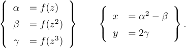

You simply use the `array` environment twice in the line:

```tex
$$\left\{
  \begin{array}{rl}
    \alpha&=f(z)\\ \beta&=f(z^2)\\ \gamma&=f(z^3)
  \end{array}
\right\}\qquad\left\{
  \begin{array}{rl}
    x&=\alpha^2-\beta\\ y&=2\gamma
  \end{array}
\right\}.$$
```

The next level of complexity occurs when you have several aligned equations with several equation numbers. Or some of the lines may be numbered and others not:

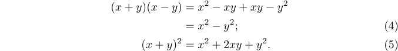

Unfortunately, even with the `eqnarray*` environment (with its improper spacing) there is no way to manually specify equation numbers in a multi-line display. Only the `amsmath` package can 
help. So, the recommended way to obtain the above result is to type:

```tex
%% Preamble
\usepackage{amsmath}
%% Body
\begin{align}
  (x+y)(x-y)&=x^2-xy+xy-y^2 \notag \\
            &=x^2-y^2; \tag4\\
  (x+y)^2   &=x^2+2xy+y^2. \tag5
\end{align}
```

If you omit both `\tag` and `\notag` on a line of the `align` environment, the equation number will be generated automatically using the current value stored in the corresponding internal counter.

If you load the `amsmath` package with the `leqno` option, the equation numbers will appear at the left-hand margin. Thus

```tex
%% Preamble
\usepackage[leqno]{amsmath}
%% Body
\begin{align}
  (x+y)(x-y)&=x^2-xy+xy-y^2 \notag \\
            &=x^2-y^2; \tag4\\
  (x+y)^2   &=x^2+2xy+y^2. \tag5
\end{align}
```
produces


To learn more about typesetting math formulas using features of the `amsmath` package, see these [articles](/tex/java/what-is-ams-latex/).

### 9.3. Long formulas

Now let's discuss what should be done when a formula is so long that it doesn't fit on a single line. For example, suppose you encounter the equation

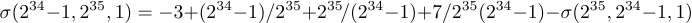

You'll have to break it up somehow; TeX has done its best to squeeze everything down together by shrinking the spaces next to '+' and '-' signs to zero, but still the line has come out overfull.

Let's try to break that equation just before the '+7'. The `array` environment leaves too much space to the right of the '=' if you use it the same way as for multi-line equations:

```tex
$$\begin{array}{rl}
  \sigma(2^{34}-1,2^{35},1)&=-3+(2^{34}-1)/2^{35}+2^{35}\!/(2^{34}-1) \\
                   &\qquad{}+7/2^{35}(2^{34}-1)-\sigma(2^{35},2^{34}-1,1)
\end{array}$$
```

So, it's best to resort to the `amsmath` package again. But this time you should use the `align*` array since the equation numbers are not needed:

```tex
%% Preamble
\usepackage{amsmath}
%% Body
\begin{align*}
  \sigma(2^{34}-1,2^{35},1)&=-3+(2^{34}-1)/2^{35}+2^{35}\!/(2^{34}-1) \\
                   &\qquad+7/2^{35}(2^{34}-1)-\sigma(2^{35},2^{34}-1,1).
\end{align*}$$
```

This yields


The idea is to treat a long one-line formula as a two-line formula, using `\qquad` on the second line so that the second part of the formula appears well to the right of the '=' sign on the first line.

It's actually not an easy task to decide how to break long displayed formulas into lines; TeX never attempts to do this, because no set of rules is really adequate. The author of a mathematical manuscript is generally the best judge of what to do, since break positions depend on subtle factors of mathematical expositions. For example, it is often desirable to emphasize some of the symmetry or other structure that underlies the formula, and such things require a solid understanding of what exactly is going on in that formula.

Nevertheless, it is possible to state a few rules of thumb about how to deal with long formulas in displays, since there are some principles that the best mathematical typesetter tends to follow:

a)	Although formulas within a paragraph always break *after* binary operations and relations, displayed formulas always break *before* binary operations and relations. That's why we didn't end the first line of our previous example with `(2^{34}-1)+`; we ended it with `(2^{34}-1` and began the second line with `+`.

b)	When an equation is broken before a binary operation, the second line should start at least two quads to the right of where the innermost subformula containing that binary operation begins on the first line. For example, if you wish to break

```tex
$$\sum_{0<k<n}\left(<formula_1>+<formula_2>\right)$$
```

at the plus sign between `<formula_1>` and `<formula_2>`, it is almost mandatory to have the plus sign on the second line appear somewhat to the right of the large left parenthesis that corresponds to `\left(`.

In the example just considered, special care is needed to break the formula into two lines, because `\left` and `\right` delimiters cannot be used in isolation: you can't have only `\left` in one line of a formula and only `\right` in the second. Furthermore, you will want the two delimiters to be of the same size, even though they occur in different lines. The best solution is usually to choose the delimiter size yourself; for example, you could type

```tex
%% Preamble
\usepackage{amsmath}
%% Body
\begin{align*}
  \sum_{0<k<n}\biggl(&<formula_1>\\
    &\qquad+<formula_2>\biggr)
\end{align*}
```

if `\bigg` delimiters are best. Notice that the `&` markers don't occur at `=` signs in this example, they just mark a point of alignment.

There's another way to break long formulas, sometimes called the *two-line* form. The idea is to put the first part of the formula almost flush left, and to put the second part almost flush right, where "almost flush" means "one quad away". Thus, the two-line form of a long sigma equation considered earlier is

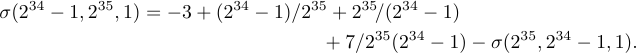

To get this two-line effect, just type:

```tex
$$\displaylines{\quad\sigma(2^{34}-1,2^{35},1)
  =-3+(2^{34}-1)/2^{35}+2^{35}\!/(2^{34}-1)\hfill{}\cr
\hfill{}+7/2^{35}(2^{34}-1)-\sigma(2^{35},2^{34}-1,1).\quad\cr}$$
```

An extra `{}` was typed on the second line here so that TeX would know that the `+` is a binary operation. The two-line form is especially recommended for equations that have a long left-hand side; in that case the break generally comes just before the = sign.
