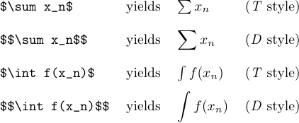
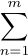
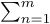
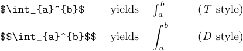
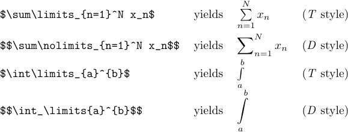
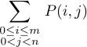

In mathematics, there are symbols that denote, for example, the "summation" or "integration" operations. They are called "large operators", and you type them just as you type ordinary symbols and letters. The difference is that TeX will choose a larger symbol for the large operator in display style than it will in text style.



A displayed `\sum` usually occurs with "limits", i.e., with subformulas that are to appear above and below it. Limits should be typed as if they were subscripts and superscripts;
`$$\sum_{n=1}^m$$` or `$$\sum^m_{n=1}$$` both produce



The normal conventions of mathematical typesetting presume that the above formula should be changed to



(i.e., without limits) if it occurs in text rather than in a display. And TeX follows these conventions.

Superscripts and subscripts on the integration sign are not set as limits even in display style:



Setting subscripts and superscripts as limits gives a better appearance if the subformulas are complex, although takes more space on the page. You can force TeX to process the formula in this way by typing `\limits` immediately after the `\int`, or `\sum`, or another operator, no matter what style will be used in the subformula. On the other hand, limits on displayed summation signs are sometimes not desirable. You can change TeX's convention by typing `\nolimits` immediately after the large operator.



If you say `\nolimits\limits` (for example, some macros like `\int` specify `\nolimits`), the last command takes precedence. The `\displaylimits` command can be used to switch to TeX's normal conventions; i.e., the limits will be displayed only in styles *D* and *D'*.

If you need to put more than one row of limits under a large operator, you can do so with `\atop`. The correct way to type the following formula is 

```tex
$$\sum_{\scriptstyle0\le i\le m\atop\scriptstyle0<j<n}P(i,j)$$.
```



The `\scriptstyle` command is necessary here, otherwise both rows of the limit would have been in scriptscript size, which is too small. This is another rare case where TeX's style rules need to be overridden.