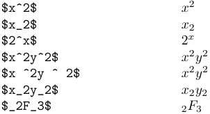
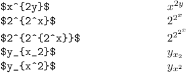
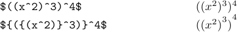
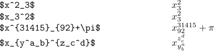
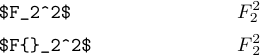
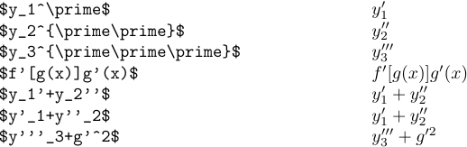

Now let's try to build more complex formulas from simple ones. First, you can get superscripts and subscripts by using `^` and `_`, as shown in the following example:

Note that `^` and `_` apply only to the next character. If you want a more complex subscript or superscript, just enclose it in braces:

The braces in these examples specify "subformulas" - simpler parts of a larger formula. TeX makes a box for each subformula and treats that box as if it were a single symbol. Braces also serve their usual purpose of grouping.

It is illegal to type `$x^y^z$` or `$x_y_z$`. TeX will complain of a "double subscript" or "double superscript". You must make clearer what you want by typing either `$x^{y^z}$`, or `$x^{yz}$`, or `$x_{y_z}$`, or `$x_{yz}$`.

A superscript or subscript following a character applies to that character only; but when following a subformula it applies to that whole subformula, and it will be raised or lowered accordingly.

In the first formula the `^3` and `^4` are superscripts on the right parentheses that immediately precede them, but in the second formula they are superscripts on the subformulas that are enclosed in braces. The first version is preferable, because it's easier to type and it's as easy to read.

Sometimes you may need to make a subscript or superscript on an empty subformula to produce some rather rare notation like *2F3*. The best way to do so is to type `${}_2F_3$` or `${_2}F_3$` or `${_2F_3}$`.

You can also have simultaneous "subsuperscripts", and you can specify them in any order:

These simultaneous "subsuperscripts" are positioned over each other. However, for some letters, a subscript will be shifted to the left; and for some of those letters quite noticeably. Compare the following two formulas:

So, if you want both subscript and superscript to be aligned, you may use the trick shown in the second version. It, again, takes advantage of an empty subformula.

The next thing that frequently occurs in math formulas is the prime symbol. LaTeX provides the `\prime` command, which itself produces a symbol of prime at the size of a normal letter. So, you would never want to use it except in a superscript or subscript. But you can simply type `'` instead of `^\prime`, and `''` instead of `^\prime\prime`, and so on.

