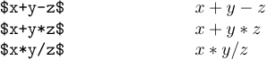
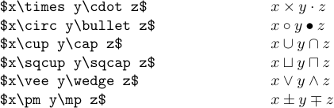
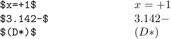
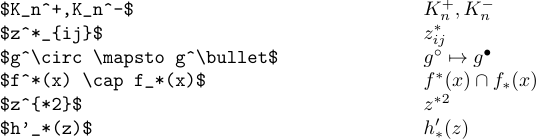
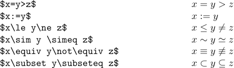
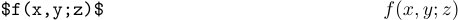
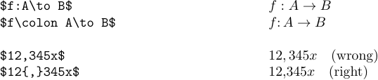
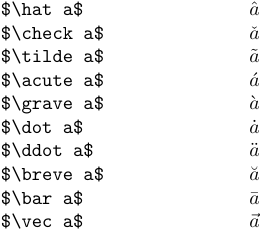
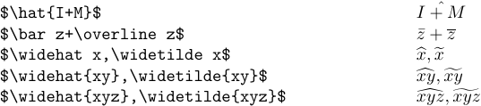

The 52 letters (`A` to `Z` and `a` to `z`) denote italic symbols, which a mathematician would call "variables". TeX calls them just "ordinary symbols", because they make up the bulk of math formulas. LaTeX also treats the following 18 characters

``0 1 2 3 4 5 6 7 8 9 ! ? . | ` @ "``

as ordinary symbols, which means that it doesn't insert any extra space when these symbols occur next to each other or next to letters. Unlike the letters, these 18 characters remain in Roman type in formulas.

The three characters `+`, `-`, and `*` are called "binary operations", because they operate on two parts of the formula. The asterisk (*) is rare, but it also behaves as a binary operation. Here are some examples of typesetting binary operations when they appear next to ordinary symbols:



TeX doesn't treat `/` as a binary operation because it would lead to incorrect spacing in such formulas as `$1/2$`. Thus, TeX treats `/` as an ordinary symbol.

Here are some more examples of binary operations:



Incidentally, binary operations are treated as ordinary symbols if they don't occur between two quantities that they can operate on. Thus, no extra space in inserted next to +, -, and * in cases like the following:



The following examples show that binary operations can be used as ordinary symbols in superscripts and subscripts:



LaTeX treats the four characters `=`, `<`, `>`, and `:` as "relations" because they express a relationship between two quantities. Such relationships have a rather different meaning from binary operations, and the symbols are typeset somewhat differently:



The two characters ',' (comma) and ';' (semicolon) are treated as punctuation marks in formulas, which means that TeX puts a little extra space after them but not before them.



It isn't customary to put extra space after a '.' (period) in formulas, so TeX treats a period as an ordinary symbol. If you want the ':' character to be a punctuation mark instead of a relation, just call it `\colon`. And if you want a comma to be treated as an ordinary symbol, just put it in braces. TeX treats anything in braces as an ordinary symbol.



The characters '(' and '[' are called "openings", while ')' and ']' are called "closings". They act much like ordinary symbols, but they help TeX to decide when a binary operation is not really being used in a binary way.

Finally, LaTeX reserves the other 10 characters:

`\ $ % # & ~ { } _ ^`

You cannot use them in math mode. Although '{' and '}' specify grouping, the commands `\{` and `\}` can be used to get '{' as an opening and '}' as a closing.

The special characters `^` and `_` should not be used except in formulas. Conversely, the names of math symbols like `\alpha` and `\approx`, and the commands for math operations like `\overline`, must not appear within ordinary text. Also, a blank line or `\par` is not allowed in math mode.

Mathematicians also like to use accents over letters as an effective way to indicate relationships between math objects. It also greatly extends the number of available symbols without increasing the number of necessary fonts. Math accents are somewhat different from the accents used in ordinary text. Spacing is not the same; TeX follows special rules for accents in formulas, so that the two sorts of accents will not be confused with each other. LaTeX provides the following math accents:



The first nine of these are called `\^`, `\v`, `\~`, `\'`, ``\` ``, `\.`, `\"`, `\u`, and `\=`, respectively, when they appear in text; `\vec` is an accent that appears only in formulas. TeX will issue an error message if you try to use `\^` or `\v`, etc., in formulas, or if you try to use `\hat` or `\check`, etc., in ordinary text.

It`s usually best to define macros for accented letters that you need frequently. You can put

```tex
\def\Ahat{{\hat A}}
\def\chat{{\hat c}}
\def\scheck{{\check s}}
```

at the beginning of a LaTeX file. This saves you a lot of keystrokes, and it makes the file easier to read.

When the letters *i* and *j* are accented in math formulas, you should use dotless symbol bases which are called `\imath` and `\jmath`. So a paper that uses hat'ed i and j might begin with the following definitions:

```tex
\def\ihat{{\hat\imath}}
\def\jhat{{\hat\jmath}}
```

It's possible to put math accents on any subformula. But there's usually not much point in doing so, because TeX just centers the accent over the whole subformula. In particular, a `\bar` accent always stays the same size; it's not like `\overline`, which grows with the formula under it. Some people prefer the longer line from `\overline` even when it applies to a single letter. However, LaTeX provides two accents that grow; they are called `\widehat` and `\widetilde`. Now let's look at the examples of cases discussed in the present paragraph.



The last example shows the maximum available size.