### 1. Lowercase Greek letters

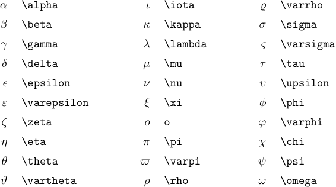

> There's no `\omicron`, since it looks the same as `o`.

### 2. Uppercase Greek letters

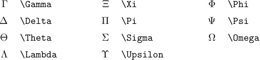

> The other Greek capitals appear in the roman alphabet (`\Alpha={\rm A}`, `\Beta={\rm B}`, etc.).

### 3. Miscellaneous symbols of type *Ord*

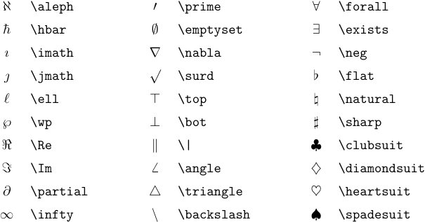

### 4. Large operators

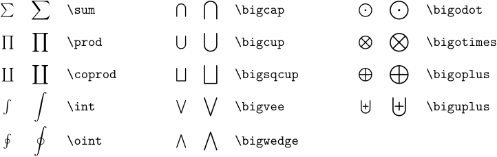

### 5. Binary operations

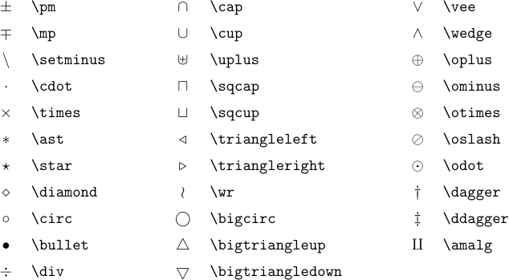

### 6. Relations

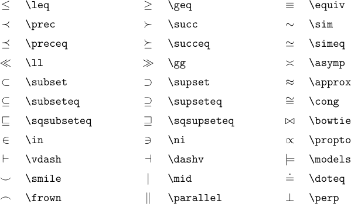

### 7. Relations

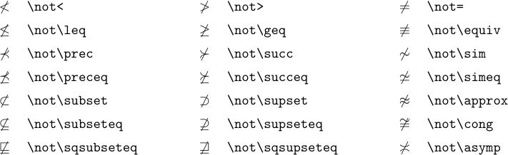

### 8. Arrows

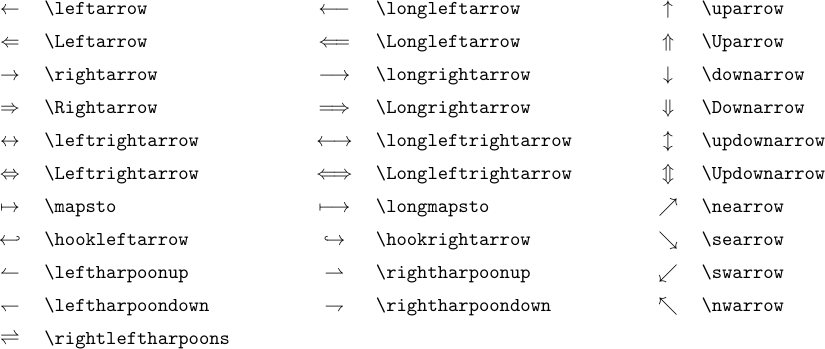

### 9. Openings

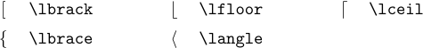

### 10. Closings

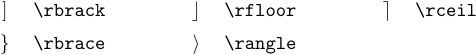

### 11. Alternate names

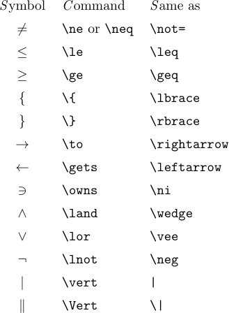

There's also `\iff`, which is just like `\Longleftrightarrow` except that it puts an extra thick space at each side.